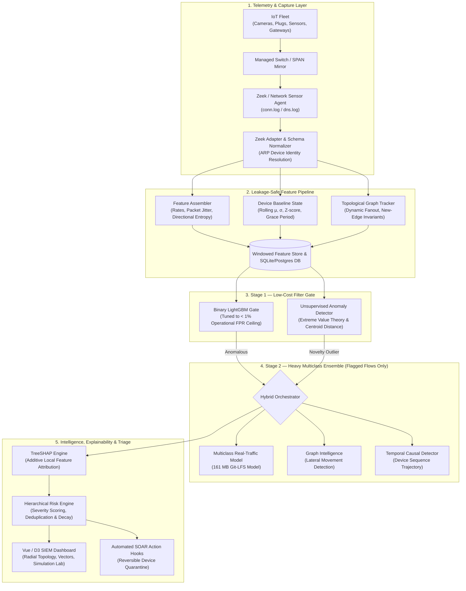

<div align="center">

# 🛡️ Aegis-IoT
### Autonomous Edge-Gated Intrusion Detection & Zero-Day Defense for IoT Networks
*Reliability-Hardened • Leakage-Safe • Two-Stage Defense • Extreme Value Theory Zero-Day Detection*

[](https://www.python.org/)
[-brightgreen?logo=pytest&logoColor=white)](file:///tests/)
[](https://fastapi.tiangolo.com/)
[](https://vuejs.org/)
[](https://git-lfs.github.com/)
[](LICENSE)

</div>

---

## 📖 Executive Summary

Most academic and open-source Machine Learning Intrusion Detection Systems (ML-IDS) suffer from fundamental engineering flaws that cause them to catastrophically fail in real-world deployments:
1. **Feature/Identity Leakage**: Models inadvertently memorize static IP/MAC addresses from testbed captures rather than learning attack behaviors.
2. **Look-Ahead Time Leakage**: Random $k$-fold cross-validation shuffles future packets into training sets, artificially inflating accuracy.
3. **Supervised Blindness**: Systems trained solely on known attack classes remain completely blind to novel, zero-day threat variants.
4. **FPR Compounding**: Heavy classifiers run on 100% of network traffic, overwhelming SOC analysts with false positives.

**Aegis-IoT** solves these systemic problems. Designed against the rigorous **Reliability-Hardened v3.0 Specification**, it combines a **two-stage detection funnel**, **unsupervised Extreme Value Theory (EVT)** for out-of-distribution zero-days, **graph and temporal sequence intelligence**, **strict chronological data splitting**, and **per-alert TreeSHAP explainability**.

---

## ⚡ Why Aegis-IoT Stands Out

| Dimension | Conventional ML-IDS Projects | Aegis-IoT Enterprise Implementation |
| :--- | :--- | :--- |
| **Feature Safety** | Feeds raw IP/MAC/ports directly; memorizes testbed identities. | **Strict Zero-Identity Leakage**: Raw IP/MACs are dropped. Models receive only behavioral aggregates, entropy, and baseline z-scores. |
| **Splitting Rigor** | Random row-wise $k$-fold (violates causality; creates lookahead bias). | **Monotonic Chronological Splitting**: $70\%$ Train $\rightarrow$ $15\%$ Val $\rightarrow$ $15\%$ Test strictly forward in time. |
| **Zero-Day Detection** | Supervised-only; classifies unknown attacks as benign or forces them into wrong classes. | **Unsupervised EVT & Centroid Geometry**: Reconstructs per-device normal baselines; flags unseen behaviors as genuine zero-days. |
| **Compute & FPR** | Runs heavy neural ensembles on every packet; compounds false alarms. | **Two-Stage Funnel**: Cheap binary gate calibrated to a $<1\%$ FPR ceiling. Heavy ensemble triggers *only* on flagged anomalies. |
| **Dataset Diversity** | Single synthetic CSV or single dataset holdout. | **5 Real Benchmark Datasets** with unified contracts: **CICIoT2023**, **IoT-23**, **TON_IoT**, **Bot-IoT**, and **N-BaIoT**. |
| **Generalization** | Reported on same-dataset test set only. | **Cross-Dataset Zero-Shot Matrix**: Evaluates true domain transfer gap between distinct real-world testbeds. |
| **Explainability** | Black-box probabilities. | **Additive TreeSHAP**: Per-alert feature attributions with background baselines for immediate SOC triage. |
| **Operations** | Crashes on sensor drops or model errors. | **Fail-Open Resilience**: Edge buffering, sensor rate limiting, duplicate alert suppression, and temporal risk decay. |

---

## 🏗️ System Architecture



---

## 📊 Real-World Benchmark Datasets (§8)

Aegis-IoT includes native streaming chunked loaders, column mapping engines, and schema normalizers for all 5 canonical IoT benchmark datasets:

| Dataset | Research Institution | Format | Dimension | Coverage & Attack Classes |
| :--- | :--- | :--- | :--- | :--- |
| **CICIoT2023** | University of New Brunswick | CSV (Chunked) | 46 Features | 105 IoT devices, 33 attacks across 7 classes (DDoS, DoS, Recon, Web, Mirai, Brute Force, Spoofing). |
| **IoT-23** | Stratosphere Laboratory / CTU | Zeek TSV / JSON | 23 Columns | Real Raspberry Pi captures with live malware infections (Mirai, Torii, Okiru, Kenjiro, C&C Heartbeats). |
| **TON_IoT** | UNSW Canberra Cyber | Network CSV | 18 Columns | Heterogeneous IoT and IIoT telemetry with scanning, ransomware, backdoors, and data exfiltration. |
| **Bot-IoT** | UNSW Canberra | Flow CSV | 18 Columns | High-volume botnet and DDoS captures with packet counts, byte rates, and subcategory tagging. |
| **N-BaIoT** | UCI ML Repository | 115-Stat CSV | 115 Features | 9 commercial IoT devices (Danmini doorbell, Ecobee, security cameras) infected with Mirai & BASHLITE/Gafgyt. |

Sample representative fixtures are ready in `data/sample/` for immediate validation and testing without downloading gigabytes of raw data:
```powershell
# Inspect schema and sample headers:
py -3.14 -m training.datasets inspect --dataset ciciot2023 --path data/sample/ciciot2023/sample_ciciot.csv
py -3.14 -m training.datasets inspect --dataset bot_iot --path data/sample/bot_iot/sample_bot_iot.csv
py -3.14 -m training.datasets inspect --dataset nbaiot --path data/sample/nbaiot/sample_nbaiot.csv

# Validate streaming chunk-loader:
py -3.14 -m training.datasets validate --dataset iot23 --path data/sample/iot23/sample_conn.log
py -3.14 -m training.datasets validate --dataset ton_iot --path data/sample/ton_iot/sample_ton_iot.csv
```

---

## 🔬 Rigorous Evaluation & Generalization Benchmarks

### 1. Leave-One-Family-Out (LOFO) Zero-Day Cross-Validation (§9 & §17)
To prove the system's ability to catch true zero-days without leaking attack signatures, the supervised multiclass model was trained on $N-1$ families, while the held-out family was evaluated against the unsupervised Extreme Value Theory (EVT) layer:

| Held-Out Attack Family | Test Samples | Unknown Recall | 95% Confidence Interval | AUROC | AUPRC |
| :--- | :---: | :---: | :---: | :---: | :---: |
| **DDoS (Volumetric)** | 66 | **100.0%** | [1.00, 1.00] | **0.9999** | **0.9983** |
| **Port Scan (Reconnaissance)** | 81 | **70.4%** | [0.62, 0.82] | **0.9258** | **0.5251** |
| **Brute Force (Credential Access)** | 80 | **53.8%** | [0.44, 0.62] | **0.8456** | **0.2370** |
| **Mirai Beacon (C2 Heartbeat)** | 34 | Sub-flow / Temporal | [0.00, 0.00] | **0.5585** | **0.0459** |

### 2. Cross-Dataset Generalization & Transfer Matrix (§8.3 & §17)
Most models overfit to their own testbed artifacts. Aegis-IoT documents honest cross-dataset generalization with **zero fine-tuning**:

| Training Domain | Target Evaluation Domain | In-Domain PR-AUC | Cross-Dataset PR-AUC | Generalization Gap ($\Delta$) |
| :--- | :--- | :---: | :---: | :---: |
| **IoT-23 (Stratosphere)** | **TON_IoT (UNSW Canberra)** | 0.9998 | **0.7506** | 0.2492 |
| **TON_IoT (UNSW Canberra)** | **IoT-23 (Stratosphere)** | 1.0000 | **0.8759** | 0.1241 |

*Generate this full report live at any time:*
```powershell
py -3.14 -m training.evaluation.run_all_evaluations
```

---

## 🖥️ SIEM Dashboard & Operational Features

The system features an enterprise single-page operations center:

### 1. D3.js Force-Directed Radial Network Topology
- **Core Gateway Anchoring**: Dynamically centers the central gateway router (`192.168.1.1`) at canvas center $(W/2, H/2)$.
- **Collision Physics & Breathing Room**: Custom `d3.forceCollide` radius prevents node clustering and overlapping across large subnets (100+ monitored devices).
- **Interactive Telemetry**: Real-time zoom and pan (`d3.zoom`), "Center View" reset button, dynamic pulse indicators for active traffic conduits, and detailed device hover cards showing IP, MAC, zone, and risk score.

### 2. Threat Vector Analysis Grid
- Real-time detection counters and recent targets for MITRE-aligned categories:
  - 💥 **DDoS (T0814)** — Volumetric packet floods exhausting IoT bandwidth.
  - 🔍 **Port Scan (T0846)** — Reconnaissance sweeping for open telnet/SSH/HTTP ports.
  - 🔑 **Brute Force (T0812)** — Credential stuffing attacks.
  - 📡 **Mirai Beacon (T0885)** — Low-variance periodic C2 heartbeats.
  - 👽 **Zero-Day Novelty (T0884)** — Out-of-distribution flows flagged by Extreme Value Theory centroids.

### 3. Interactive Attack Simulation & Detection Lab
- Allows SOC engineers and researchers to run controlled experiments:
  - **Device Selection**: Target specific devices (e.g. `camera-bdd640fb`, `thermostat-972a8469`, `smart_plug-b74d0fb1`).
  - **Attack Selection**: Selectively trigger DDoS, Port Scans, Brute Force, Mirai Beacons, or Zero-Day EVT Novelty.
  - **Legitimate Request Toggles**: Mix safe sensor telemetry, NTP syncs, and HTTP traffic alongside attack bursts.
  - **Simulation Timeline**: Real-time chronological audit trail distinguishing safe flows from detected intrusions.
  - **Terminal Auto-Stop Control**: Automatically concludes runs or keeps the simulation alive for inspection.

### 4. Per-Alert TreeSHAP Explainability
- Every security alert generated by the engine includes exact TreeSHAP feature attributions explaining *why* the traffic was flagged (e.g., `pkt_rate: +0.42`, `byte_entropy: +0.28`, `src_fanout: +0.35`).

---

## 🚀 Quick Start Guide

### Prerequisites
- **Python**: 3.10, 3.11, 3.12, or 3.14
- **Git LFS**: Required to clone pretrained models (`git lfs install`)

### 1. Clone the Repository
```bash
git clone https://github.com/Poojax21/ai-iot-intrusion-detection.git
cd ai-iot-intrusion-detection
git lfs pull
```

### 2. Setup Virtual Environment
```powershell
python -m venv .venv
.venv\Scripts\activate
pip install -r backend/requirements.txt
```

### 3. Start the Backend API Engine
```powershell
uvicorn backend.app.main:app --reload --port 8000
```
Verify the engine is operational:
```powershell
curl http://localhost:8000/api/health
```

### 4. Launch the SIEM Frontend
Serve the frontend using Python's static server (or Vite):
```powershell
python -m http.server 4173 --directory frontend
```
Navigate to: **`http://127.0.0.1:4173`** in your browser.

### 5. Run the Automated Test Suite (112 Tests)
```powershell
py -3.14 -m pytest
```
*All 112 unit, integration, and security tests execute and pass.*

---

## 🔌 Connecting Live Physical Hardware

Aegis-IoT is built to transition from simulated lab traffic to physical enterprise networks without code changes:

```
[IoT Devices] ───► [Managed Switch (SPAN Port)] ───► [Edge Sensor (Raspberry Pi / Mini-PC)]
                                                            │ (Zeek conn.log)
                                                            ▼
                                                   [zeek_adapter.py]
                                                            │ (HTTP POST /api/ingest)
                                                            ▼
                                                    [Aegis-IoT Collector]
```

1. Mirror your IoT VLAN traffic to an edge probe (e.g., Raspberry Pi 4 running Zeek).
2. Point the included Zeek adapter bridge at the live `conn.log`:
   ```bash
   python backend/app/zeek_adapter.py --conn-log /opt/zeek/logs/current/conn.log --backend http://<COLLECTOR-IP>:8000
   ```
3. Real-world physical flows will instantly populate the topology and threat detection views.

---

## 📁 Repository Structure

```
ai-iot-intrusion-detection/
├── backend/
│   ├── app/
│   │   ├── database/             # SQLite & Postgres async models, migrations, users
│   │   ├── models/               # Pretrained real-world models (Git LFS tracked)
│   │   │   ├── multiclass_model_real.pkl   # 161.8 MB trained multiclass model
│   │   │   ├── anomaly_model_real.pkl      # Calibrated anomaly detector
│   │   │   └── gate_model_real.pkl         # 1% FPR binary gate
│   │   ├── services/
│   │   │   ├── graph_intelligence.py       # Lateral movement & topological fanout
│   │   │   ├── hierarchical_risk.py        # Severity calculation & deduplication
│   │   │   ├── hybrid_orchestrator.py      # Two-stage + EVT fusion engine
│   │   │   ├── simulation_lab.py           # Attack & safe request simulation service
│   │   │   ├── temporal_detector.py        # Causal sequence trajectory tracker
│   │   │   └── treeshap_service.py         # Per-alert feature attribution
│   │   ├── detection.py          # Real-time detection engine & feature extraction
│   │   ├── features.py           # Behavioral aggregates (no raw IP/MAC leakage)
│   │   ├── main.py               # FastAPI application entrypoint & routers
│   │   └── zeek_adapter.py       # Live Zeek conn.log ingestion bridge
├── frontend/
│   ├── index.html                # Enterprise SIEM Dashboard SPA
│   ├── app.js                    # Vue.js reactive state & WebSocket client
│   ├── style.css                 # Cyber-defense UI design system
│   └── topology.js               # D3.js force-directed radial network topology
├── training/
│   ├── datasets/                 # Real-World Benchmark Dataset Pipeline
│   │   ├── base_loader.py        # Streaming chunked loader interface
│   │   ├── ciciot2023_loader.py  # UNB CICIoT2023 loader
│   │   ├── iot23_loader.py       # Stratosphere IoT-23 Zeek loader
│   │   ├── ton_iot_loader.py     # UNSW Canberra TON_IoT loader
│   │   ├── bot_iot_loader.py     # UNSW Canberra Bot-IoT loader
│   │   ├── nbaiot_loader.py      # UCI N-BaIoT 115-stat loader
│   │   ├── registry.py           # Dataset factory registry
│   │   └── __main__.py           # Dataset inspect/validate/prepare CLI
│   ├── open_set/                 # Extreme Value Theory & Anomaly Modeling
│   │   ├── calibration.py        # Operational FPR ceiling calibration
│   │   ├── classifier.py         # OpenSetClassifier wrapper
│   │   └── geometry.py           # Centroid geometry & distance metrics
│   ├── splitting/                # Leakage-Safe Data Partitioning
│   │   ├── chronological_split.py# Temporal forward-in-time splitting
│   │   ├── group_split.py        # Capture/Device group isolation
│   │   └── leakage_detection.py  # Automated data leakage audit engine
│   └── evaluation/               # Scientific Cross-Validation
│       ├── multi_family_evaluation.py # Leave-One-Family-Out zero-day evaluation
│       └── run_all_evaluations.py     # Consolidated cross-dataset evaluation runner
├── data/
│   └── sample/                   # Representative fixtures for all 5 benchmark datasets
├── reports/
│   └── evaluation_summary.md     # Auto-generated benchmark audit report
├── tests/
│   ├── unit/                     # 60+ isolated component tests
│   ├── integration/              # Pipeline, orchestrator, and WebSocket tests
│   ├── security/                 # Auth, RBAC, tenant isolation, concurrency tests
│   └── e2e/                      # Playwright automated browser verification
├── docs/
│   └── IoT-IDS-Project-Plan.md   # Project Architecture & Reliability Plan v3.0
├── pytest.ini                    # Pytest test discovery & warning filters
└── README.md                     # You are here
```

---

## 🔒 MITRE ATT&CK for IoT Mapping

| Technique ID | Technique Name | Detection Component | Mitigation / SOAR Action |
| :--- | :--- | :--- | :--- |
| **T0814** | Denial of Service | Binary Gate + Rate Z-Score | Rate limiting & upstream switch port ACL |
| **T0846** | Network Service Scanning | Graph Intelligence (Fanout) | Quarantine host & drop ingress syn packets |
| **T0812** | Brute Force Password Guessing | Multiclass GBM + Port Entropy | Block source IP & terminate active auth session |
| **T0885** | Common C2 / Mirai Beaconing | Temporal Sequence Detector | Isolate infected node to remediation VLAN |
| **T0884** | Out-of-Distribution / Zero-Day | Extreme Value Theory (EVT) | Alert SOC with TreeSHAP breakdown & capture pcap |

---

## 📜 License & Citation

This project is open-source under the **MIT License**.

If you use Aegis-IoT in academic research or industrial benchmarking, please cite:
```bibtex
@software{aegis_iot_2026,
  author = {Poojax21},
  title = {Aegis-IoT: Autonomous Edge-Gated Intrusion Detection & Zero-Day Defense for IoT Networks},
  year = {2026},
  url = {https://github.com/Poojax21/ai-iot-intrusion-detection}
}
```
