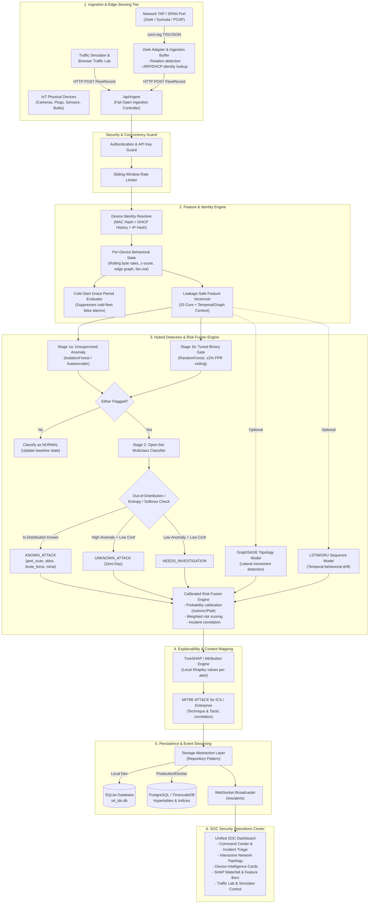

# Pahredaar-IoT — Target System Architecture Specification
**Document Version:** 2.0 (Research-Grade Platform)  
**Status:** Approved Architecture Blueprint  

---

## 1. System Vision & Architecture Principles

Pahredaar-IoT is designed as an edge-native, explainable, hybrid intrusion detection and behavioral monitoring platform for Internet of Things (IoT) and Industrial IoT (IIoT) networks. 

The architecture adheres to six foundational engineering principles:

1. **Defense-in-Depth & Hybrid Modeling:** No single model family solves network security. The platform integrates statistical baselining, unsupervised anomaly detection (for novel zero-days), calibrated supervised classification (for high-confidence known signatures), graph neural networks (for lateral movement), and recurrent models (for temporal drift).
2. **Leakage-Safe Feature Engineering:** Network addresses (IPs, MACs, ports) are **never** treated as categorical tokens for models to memorize. They are solely used as partition keys to compute behavioral indicators (packet dynamics, fan-out, z-scores, edge novelty).
3. **Calibrated Open-Set Triage:** In real networks, unseen traffic must not be forced into a closed set of training labels. The engine categorizes traffic into four explicit states: `NORMAL`, `KNOWN_ATTACK`, `UNKNOWN_ATTACK`, and `NEEDS_INVESTIGATION`.
4. **Model-Faithful Explainability:** Security analysts must understand *why* an alert fired. Explanations must be mathematically grounded in feature Shapley values (TreeSHAP) or explicit delta attributions, mapped directly to MITRE ATT&CK techniques.
5. **Fail-Open Operational Resilience:** Detector unavailability, model reloading, or network backpressure must never block network traffic ingestion. Ingestion buffers events locally and fails open.
6. **Zero-Friction Dual-Mode Deployment:** The platform runs smoothly on a single laptop using embedded storage (`SQLite`) and mock sensors, while also deploying via `Docker Compose` with enterprise storage (`PostgreSQL` / `TimescaleDB` / `Redis`) for lab or production environments.

---

## 2. End-to-End Target Architecture Diagram

---

## 3. Subsystem Specifications

### 3.1 Feature Pipeline & Device State
Every flow is mapped into a normalized vector of behavioral metrics:
1. `duration`: Flow duration in seconds.
2. `orig_bytes`, `resp_bytes`: Byte counters in originator and responder directions.
3. `orig_pkts`, `resp_pkts`: Packet counters.
4. `total_bytes`, `total_pkts`: Aggregate flow volume.
5. `byte_rate`, `pkt_rate`: Flow throughput rates per unit time.
6. `avg_pkt_size`: Mean packet size.
7. `is_new_edge`: Boolean indicator (1.0 or 0.0) indicating whether this source-destination IP pair has been observed previously.
8. `src_fanout_recent`: Cardinality of unique destination IPs targeted by this device within a 30-event sliding window.
9. `device_zscore`: Standard score of current byte rate relative to the device's own rolling history (not global network average).
10. `proto_tcp`, `proto_udp`, `proto_icmp`: One-hot transport layer protocol encoding.
11. `conn_state_sf`, `conn_state_s0`, `conn_state_rej`, `conn_state_other`: One-hot Zeek connection state flags.

### 3.2 Dual-Mode Storage Architecture
To preserve seamless local development while enabling enterprise deployment:
- **`StorageEngine` Abstract Base Class:** Defines consistent async/sync interfaces for `record_flow()`, `record_alert()`, `list_alerts()`, `list_devices()`, `get_stats()`, and incident management.
- **`SQLiteStorageEngine`:** Embedded zero-dependency engine with schema migrations, WAL mode for high concurrency, and automated index optimization.
- **`PostgreSQLStorageEngine`:** Connection-pooled engine using TimescaleDB hypertables for `flows` and relational constraints for users, incidents, and audit logs.

### 3.3 Security & Role-Based Access Control (RBAC)
- **Roles:**
  - `admin`: Full system configuration, user management, model management, sensor provisioning.
  - `analyst`: Alert triage, incident annotation, device risk overrides, traffic lab execution.
  - `viewer`: Read-only access to dashboard and reporting metrics.
  - `sensor`: Dedicated ingestion identity using scoped API tokens (`X-Sensor-Key`).
- **Token Format:** Cryptographically signed JWT tokens with standard expiration and refresh lifecycle.
