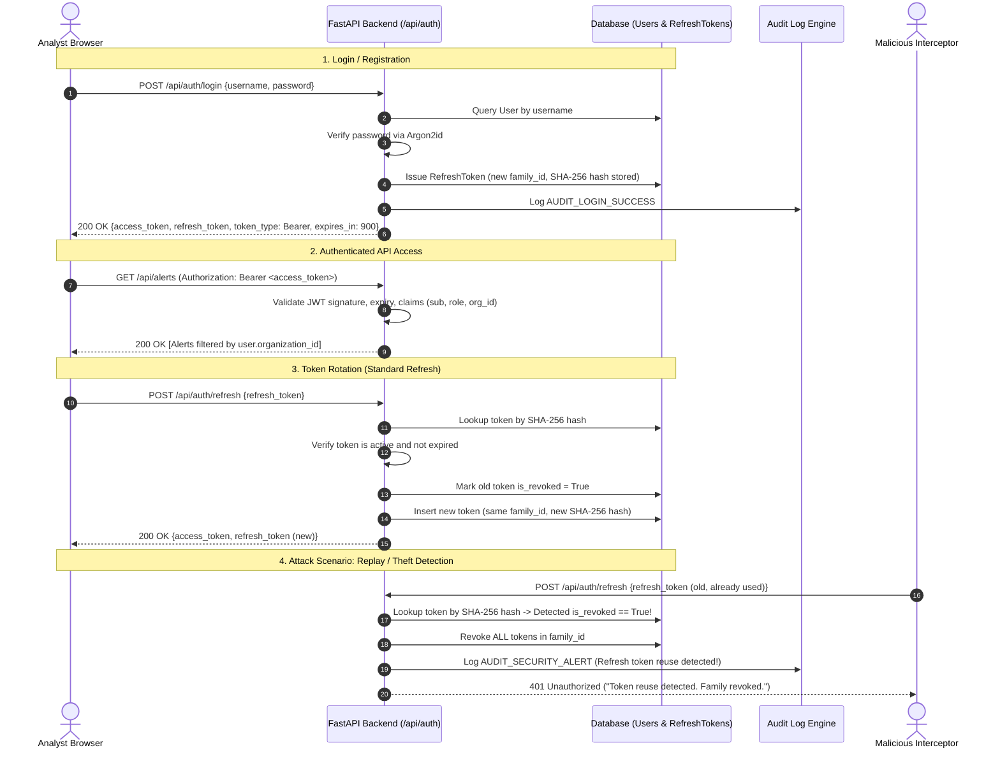

# Authentication & Identity Architecture

This document describes the Enterprise Authentication, Token Lifecycle, and Security Architecture implemented in **Phase 6** of Pahredaar-IoT.

---

## 1. Authentication Core Principles

Pahredaar-IoT enforces a zero-trust, stateless identity model with defense-in-depth:
- **Argon2id Password Hashing:** Passwords are never stored in plaintext or with weak legacy hashes. Argon2id is configured with memory cost 65536 KiB, time cost 3 iterations, and parallelism 4.
- **Short-Lived Access Tokens:** Signed JSON Web Tokens (JWT) using HS256 (default) or RS256/ES256 (production configurable) with a default lifetime of 15 minutes (`ACCESS_TOKEN_EXPIRE_MINUTES=15`).
- **Cryptographic Refresh Token Rotation (RTR):** Refresh tokens are single-use random 256-bit entropy tokens (`secrets.token_urlsafe(48)`), valid for 7 days (`REFRESH_TOKEN_EXPIRE_DAYS=7`).
- **Family-Based Reuse Detection:** Every refresh token belongs to a cryptographically linked token family (`family_id`). If an already-rotated or revoked token is reused (indicating token theft or man-in-the-middle attack), the entire token family is immediately revoked, forcing re-authentication, and a high-severity security audit event is logged.
- **Dual Identity Channels:**
  - **Human Operators & Analysts:** Authenticated via JWT bearer tokens in `Authorization: Bearer <token>` HTTP header or `?token=` WebSocket query param.
  - **Network Sensors & Edge Collectors:** Authenticated via SHA-256 hashed API keys (`X-Sensor-Key: pds_...`) scoped to their registered organization.

---

## 2. Token Lifecycle Diagram

---

## 3. Password Security Policy

Passwords submitted during `/api/auth/register` must satisfy rigorous enterprise complexity criteria:
- **Minimum Length:** 12 characters (`AUTH_PASSWORD_MIN_LENGTH=12`).
- **Uppercase Character:** At least 1 `[A-Z]`.
- **Lowercase Character:** At least 1 `[a-z]`.
- **Digit:** At least 1 `[0-9]`.
- **Special Character:** At least 1 symbol (`[!@#$%^&*()_+\-=\[\]{}|;:,.<>?]`).
- Violations trigger an immediate `422 Unprocessable Entity` or `400 Bad Request` with descriptive feedback.

---

## 4. Endpoints & API Reference

| Endpoint | Method | RBAC Scope | Description |
| :--- | :--- | :--- | :--- |
| `/api/auth/register` | `POST` | Public / Admin | Register new tenant user with password validation |
| `/api/auth/login` | `POST` | Public | Authenticate with username & password, returns JWT pair |
| `/api/auth/refresh` | `POST` | Public | Rotate refresh token and obtain fresh access token |
| `/api/auth/logout` | `POST` | Authenticated | Revoke caller's active refresh token |
| `/api/auth/me` | `GET` | Authenticated | Return authenticated caller profile, role, and organization |

---

## 5. WebSocket Authentication

Real-time alert streaming (`/ws/alerts`) validates identity at connection initiation:
- **Connection URI:** `/ws/alerts?token=<jwt_access_token>`
- If token is missing, invalid, or expired, the backend sends a structured error message (`{"error": "Unauthorized"}`) and terminates the connection with WebSocket closure code `1008` (Policy Violation).
- Successfully connected clients are registered into an organization-scoped WebSocket channel manager, guaranteeing cross-tenant alert isolation.
