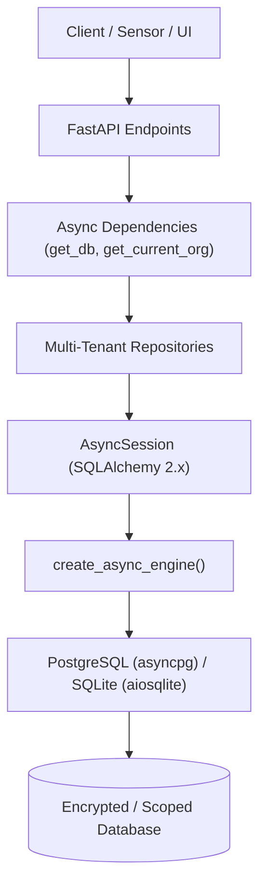

# Phase 6 Database Architecture Guide

**Project:** Pahredaar-IoT Enterprise Intrusion Detection Platform  
**Architecture:** Asynchronous SQLAlchemy 2.x ORM with Dual Engine Support (PostgreSQL / SQLite)  
**Schema Version:** 1.0.0 (Alembic Managed)  

---

## 1. Architectural Overview

Pahredaar-IoT features a database architecture designed for high-concurrency packet flow ingestion, real-time threat intelligence, and strict multi-tenant isolation.

### 1.1 Dual-Engine Abstraction
- **Enterprise Mode (`postgresql+asyncpg`):** High-throughput network flow recording, JSONB indexing, connection pooling (`QueuePool`), and optional TimescaleDB hypertable partitioning.
- **Development & Standalone Mode (`sqlite+aiosqlite`):** Zero-infrastructure local execution, embedded file-based storage, backward-compatible with Phase 1–5 development environments.

---

## 2. Model Catalog & Schema Specifications

### 2.1 Identity & Governance
- **`organizations` (`backend/app/database/models/organization.py`)**: Master tenant entity. Controls tenant status, settings, and scopes all data.
- **`users` (`backend/app/database/models/user.py`)**: System operators. Securely stores Argon2id password hashes (`password_hash`), assigned roles (`admin`, `analyst`, `viewer`), and multi-tenant scoping (`organization_id`).
- **`refresh_tokens` (`backend/app/database/models/user.py`)**: Ephemeral refresh credentials. Stores SHA-256 token hashes, expiration timestamps, family IDs for reuse detection, and revocation flags.
- **`sensors` (`backend/app/database/models/sensor.py`)**: Remote network capture probes (Zeek adapters). Stores SHA-256 API key hashes, custom rate limits (`rate_limit_per_sec`), and heartbeat metrics.

### 2.2 Asset & Threat Models
- **`devices` (`backend/app/database/models/device.py`)**: Discovered IoT network nodes with MAC/IP, device type, risk tier, and continuous temporal/graph threat state.
- **`network_flows` (`backend/app/database/models/flow.py`)**: Captured bidirectional flow records, extracted features (JSONB/JSON), gate scores, and flag decisions.
- **`alerts` (`backend/app/database/models/alert.py`)**: Threat detection alerts including TreeSHAP local explanations, novelty scores, reason codes, and risk decompositions.
- **`incidents` (`backend/app/database/models/incident.py`)**: Correlated security incidents with lifecycle transitions (`OPEN` $\to$ `ACKNOWLEDGED` $\to$ `RESOLVED`), MTTA/MTTR timestamps, and resolution notes.
- **`risk_history` (`backend/app/database/models/risk_history.py`)**: Time-series log of composite device risk and event threats over time.
- **`audit_events` (`backend/app/database/models/audit.py`)**: Immutable append-only audit trail capturing security-sensitive actions.
- **`model_metadata` (`backend/app/database/models/model_metadata.py`)**: Version tracking, artifact SHA-256 checksums, and deployment timestamps.

---

## 3. Connection Pooling & Transaction Management

Connection pooling is configured in `backend/app/database/engine.py`:
- `pool_size = 10` (default, configurable via `DB_POOL_SIZE`)
- `max_overflow = 20` (default, configurable via `DB_MAX_OVERFLOW`)
- `pool_timeout = 30.0` seconds
- `pool_recycle = 1800` seconds (prevents stale TCP connections)
- `pool_pre_ping = True` (detects dropped connections before execution)

Each FastAPI request obtains an isolated `AsyncSession` via `get_db()`. Sessions automatically rollback upon unhandled exceptions and close cleanly in a `finally` block, eliminating connection leaks.
