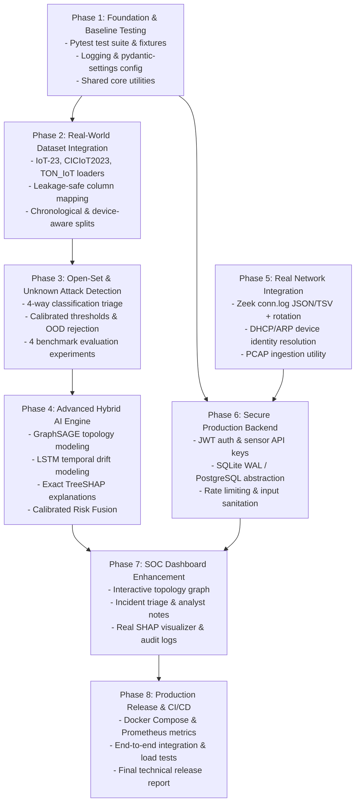

# Pahredaar-IoT — Implementation Roadmap & Execution Plan
**Version:** 2.0  
**Methodology:** Incremental, Phase-Gated Quality Engineering  

---

## 1. Roadmap Overview & Dependency Graph

---

## 2. Phase-by-Phase Plan & Acceptance Gates

### Phase 1: Codebase Audit & Foundation (Current Phase)
- **Objectives:**
  1. Inspect and document codebase architecture, deficiencies, and dependencies.
  2. Implement configuration validation using `pydantic-settings` with `.env` support.
  3. Establish structured logging with ISO timestamps and contextual metadata.
  4. Build automated test suite (`pytest`) covering:
     - Model loading and feature scaler alignment.
     - Feature extraction invariants and `DeviceState` behavior.
     - Storage initialization and record insertions.
     - API endpoints (`/api/health`, `/api/ingest`, `/api/alerts`, `/api/devices`, `/api/stats`).
     - WebSocket subscription and alert push.
     - Simulator flow generation logic.
  5. Consolidate shared logic between `backend`, `simulator`, and `training` into a clean package structure without breaking backwards compatibility.
- **Acceptance Criteria:**
  - `pytest` runs and 100% of baseline tests pass.
  - V1 server starts cleanly and serves frontend at `http://127.0.0.1:4173/`.
  - Simulator streams flows and receives alerts without errors.
  - All existing model `.pkl` and `.json` artifacts remain untouched and verified.

---

### Phase 2: Real-World Dataset Integration
- **Objectives:**
  1. Implement `load_real_dataset()` for:
     - **IoT-23** (Avast Software capture of malware/Mirai and benign smart home traffic).
     - **CICIoT2023** (University of New Brunswick 33-attack IoT dataset).
     - **TON_IoT** (UNSW Canberra IoT testbed telemetry and network flows).
  2. Implement dataset-specific column adapters mapping raw fields to standard `FlowRecord` schema.
  3. Implement leakage-safe preprocessing (strip static IPs/MACs; apply capture-aware or chronological splits).
  4. Build benchmark data verification scripts and unit tests for each loader.
- **Acceptance Criteria:**
  - Automated tests verify correct schema parsing for each dataset.
  - Missing values and malformed rows are handled with clear diagnostic logs.
  - No synthetic placeholders or fake metrics used.

---

### Phase 3: Open-Set & Unknown Attack Detection
- **Objectives:**
  1. Upgrade decision engine from closed-set multiclass to 4-way triage:
     - `NORMAL`: No anomaly detected and low gate probability.
     - `KNOWN_ATTACK`: Flagged by gate/anomaly, and multiclass classifier has high confidence.
     - `UNKNOWN_ATTACK`: Flagged by gate/anomaly, but multiclass classifier confidence is below OOD rejection threshold (novel zero-day).
     - `NEEDS_INVESTIGATION`: Anomaly score elevated near boundary but below definitive attack threshold.
  2. Calibrate probability scores using temperature scaling or isotonic regression.
  3. Execute 4 evaluation experiments:
     - *Exp A:* In-domain known attack evaluation.
     - *Exp B:* Hold-out attack class (leave-one-group-out) zero-day rejection evaluation.
     - *Exp C:* Cross-dataset transfer generalization.
     - *Exp D:* Unseen device type baseline evaluation.
- **Acceptance Criteria:**
  - Unseen attack types are flagged as `UNKNOWN_ATTACK` rather than forced into wrong attack classes.
  - Precision, Recall, F1, FPR, ROC-AUC, PR-AUC, and OOD Detection Rate documented per class.
  - Operational FPR $\le 2\%$ ceiling maintained.

---

### Phase 4: Advanced Hybrid AI Engine
- **Objectives:**
  1. **GraphSAGE Network Topology Model:** Construct subnet communication graphs using PyTorch Geometric; compute node embeddings to detect anomalous lateral movement.
  2. **LSTM Per-Device Temporal Model:** Model per-device sequential flow transitions to detect stealthy low-and-slow behavioral drift.
  3. **Exact TreeSHAP:** Integrate `shap.TreeExplainer` on RandomForest gate/multiclass models for mathematically rigorous feature attribution.
  4. **Risk Fusion Engine:** Calibrated probability combination incorporating anomaly score, gate score, multiclass confidence, graph score, and temporal deviation.
  5. **Modularity & Graceful Degradation:** The IDS operates seamlessly if advanced models are omitted or disabled.
- **Acceptance Criteria:**
  - Independent benchmarks comparing V1 baseline vs. V2 hybrid ensemble.
  - SHAP explanation values sum to model prediction minus expected value within numerical tolerance.
  - Engine operates without failure if PyTorch / GraphSAGE models are disabled.

---

### Phase 5: Real Network Integration (Zeek & Edge)
- **Objectives:**
  1. Enhance `zeek_adapter.py` to support:
     - TSV and JSON-lines `conn.log` formats.
     - Log file rotation (inode changes, truncation, EOF re-opening).
     - Robust in-memory circular buffer with persistent disk spillover during network partition.
  2. Implement ARP and DHCP lease table parsing to map dynamic IP addresses to immutable hardware MAC hashes.
  3. Implement PCAP direct analysis tool using Zeek or TShark CLI to ingest offline captures directly into `/api/ingest`.
- **Acceptance Criteria:**
  - Real Zeek log streaming successfully updates live device baselines and alerts.
  - Simulated DHCP address changes maintain device historical continuity without resetting baselines.

---

### Phase 6: Secure Production Backend
- **Objectives:**
  1. Implement JWT authentication with access and refresh tokens.
  2. Implement Role-Based Access Control (`admin`, `analyst`, `viewer`).
  3. Implement Sensor API Key management (`X-Sensor-Key`) with granular write-only ingestion permissions.
  4. Restrict CORS to configured origins; add token bucket rate limiting on `/api/ingest`.
  5. Implement database abstraction layer supporting SQLite WAL mode and PostgreSQL/TimescaleDB.
  6. Add database schema migrations.
- **Acceptance Criteria:**
  - Unauthenticated requests to protected endpoints return HTTP 401/403.
  - Valid sensor keys allow ingestion; invalid keys are rejected.
  - Local SQLite works out of the box; PostgreSQL connects seamlessly when configured.

---

### Phase 7: Professional SOC Dashboard
- **Objectives:**
  1. Redesign and expand `frontend/index.html` into a modular, cyber-analyst operational interface:
     - Command Center: real-time threat KPIs, throughput charts, alert feed.
     - Network Topology: interactive D3/SVG canvas showing IoT device nodes, subnets, and suspicious communication arcs.
     - Device Intelligence: historical flow trends, risk score decay graphs, and protocol breakdowns.
     - Incident Management: grouping alerts into triageable incidents with analyst notes and status tracking.
     - Explainability View: exact SHAP waterfall chart and feature importance breakdown.
     - Model & Sensor Monitoring: real-time model health, drift alerts, and sensor heartbeats.
  2. Maintain 100% backwards compatibility with Traffic Lab and existing WebSocket protocol.
- **Acceptance Criteria:**
  - All views render live data from backend APIs with zero hardcoded mock values.
  - WebSocket auto-reconnects with exponential backoff on server restart.

---

### Phase 8: Validation, Release & Documentation
- **Objectives:**
  1. Package complete platform into reproducible `docker-compose.yml` (FastAPI backend, PostgreSQL/TimescaleDB, Redis, Frontend Nginx).
  2. Provide Prometheus `/metrics` endpoint and Grafana dashboard templates.
  3. Conduct security review (SQLi, auth bypass, rate limit verification, payload validation).
  4. Produce comprehensive release documentation:
     - `docs/DEPLOYMENT.md`
     - `docs/TESTING.md`
     - `docs/SECURITY.md`
     - `docs/MODEL_EVALUATION.md`
     - `docs/FINAL_TECHNICAL_REPORT.md`
- **Acceptance Criteria:**
  - Single command `docker compose up -d` launches complete environment.
  - Full test suite passes with zero regressions.
