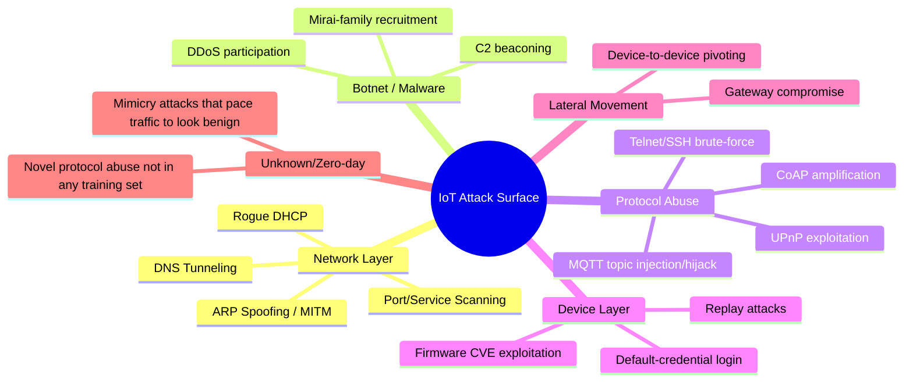
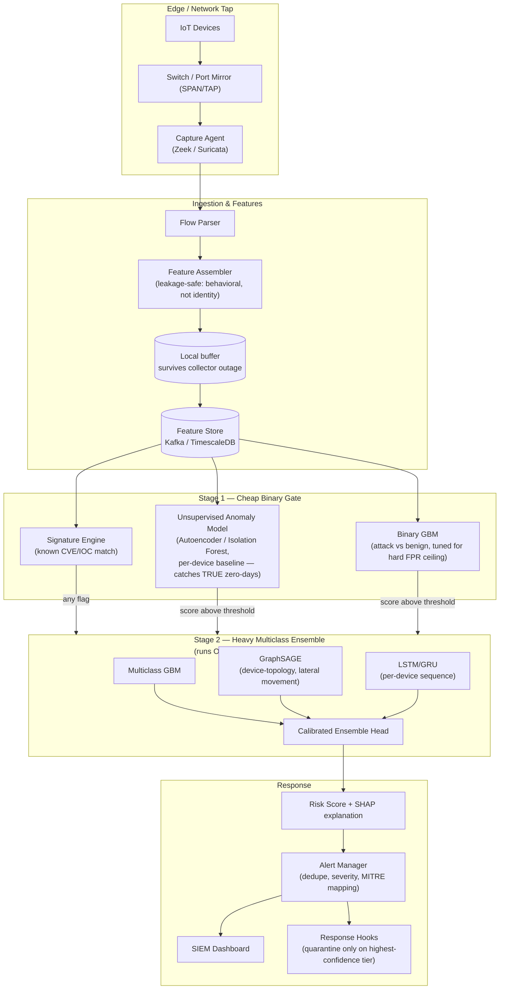
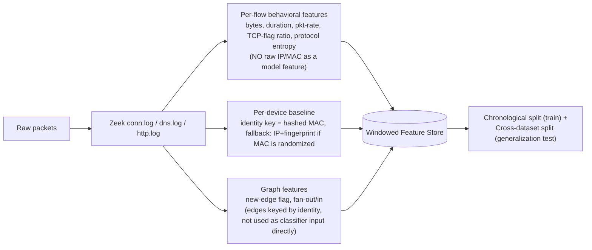
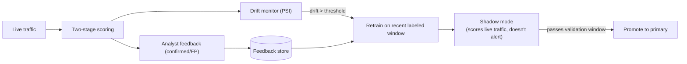
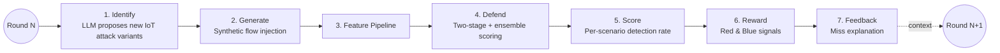
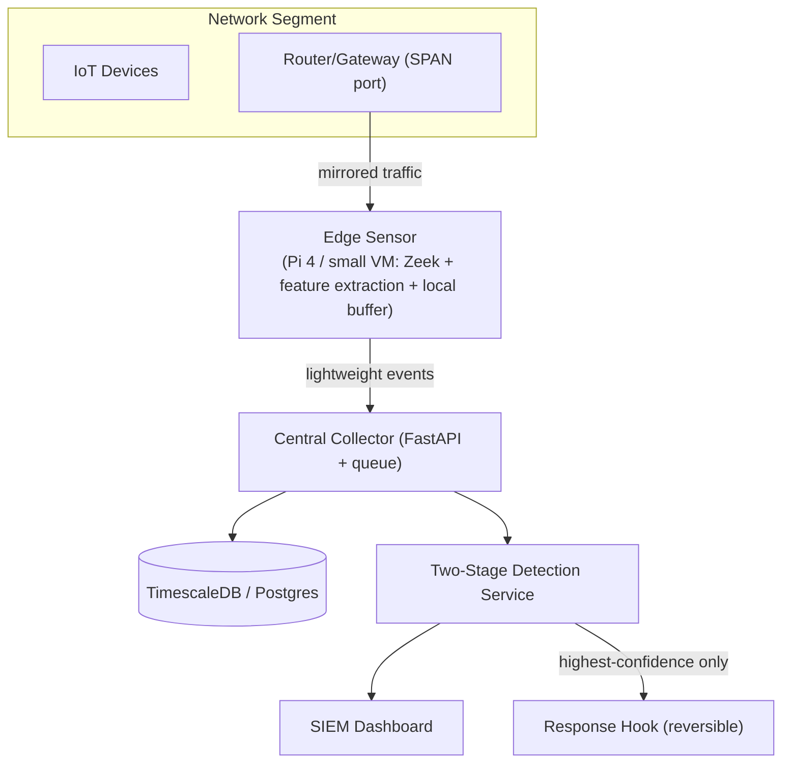
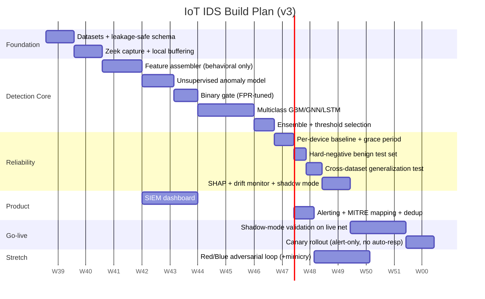

# Pahredaar-IoT: Intrusion Detection System for IoT Devices
### Project Plan v3.0 — Reliability-Hardened

---

## 1. Overview

An **Intrusion Detection System (IDS)** for IoT networks — home, industrial (IIoT), or campus deployments where many resource-constrained devices (cameras, sensors, smart plugs, PLCs, gateways) share a network and are chronically under-patched.

Architecture pattern reused from your `Pahredaar` fraud-simulation project: ensemble defense + closed feedback loop. v3 fixes the gaps a v2 prototype would hit in a real deployment — supervised-only detection, dataset leakage, and no operational failure handling.

---

## 2. What Changed in v3 (reliability fixes)

| Issue in v2 | Fix in v3 |
|---|---|
| Ensemble was 100% supervised — blind to genuinely novel attacks | Added an **unsupervised anomaly layer** (autoencoder/Isolation Forest) that needs no attack labels (§7) |
| All 3 models scored every flow — FPR compounds across models | Added a **two-stage pipeline**: cheap binary gate first, heavy multiclass ensemble only on flagged traffic (§6) |
| Public IoT datasets have known feature-leakage/overfitting issues, unaddressed | Added leakage-safe feature rules + **cross-dataset generalization test**, not just same-dataset holdout (§5, §9) |
| No behavior defined for sensor/collector outage | Added fail-open policy, local buffering, backpressure handling (§11) |
| No privacy/retention stance for a system that watches home/office traffic | Added explicit data-handling rules (§11) |
| No rollout safety net for a new model | Added shadow-mode + canary go-live checklist (§18) |
| MAC-based device ID assumed stable | Called out MAC-randomization caveat + fallback fingerprinting (§7) |

---

## 3. Objectives

| # | Objective |
|---|---|
| 1 | Detect known IoT attack classes in real time (Mirai/botnet, DDoS, scanning, brute-force, ARP spoofing, MQTT/CoAP abuse, DNS tunneling, CVE exploitation) |
| 2 | Detect **unknown/zero-day** anomalies via unsupervised behavioral modeling, not just held-out classes |
| 3 | Run on resource-constrained edge (gateway-level capture), not on the IoT devices themselves |
| 4 | Low false-positive rate under a hard operational ceiling, with a defined failure mode when the detector itself is degraded |
| 5 | SIEM-style dashboard with per-alert explainability |
| 6 | (Stretch) Adversarial self-play loop for continuous robustness testing |

---

## 4. Threat Model



---

## 5. Known Dataset Pitfalls & How This Plan Handles Them

Public IoT-IDS benchmarks (CICIoT2023, Bot-IoT, TON_IoT, N-BaIoT, IoT-23) are widely used but have documented reliability problems that inflate reported accuracy far above real-world performance:

| Pitfall (reported in the literature, e.g. the *IoTGeM* study on generalizable IoT attack models) | Concrete effect | Mitigation used here |
|---|---|---|
| **Feature/identity leakage** — attacker traffic was generated from a small, fixed set of source IPs/ports/session artifacts that trivially separate the label | A model "learns" the attacker's IP, not the attack's behavior; falls apart on any new IP | Never use raw IP/MAC as a categorical model feature. Use them only to *derive* behavioral aggregates (rate, fan-out, new-edge flag) — never as an identity token the model memorizes |
| **Highly skewed, near-random feature distributions per device** (documented specifically for CICIoT2023) | A single global model trained across all devices sees mostly noise | Per-device baselining (§10), not a single global classifier |
| **Inconsistent attack-to-device mapping vs. paper's stated methodology** | Benchmarks silently include attacks that were not actually run against the devices the paper implies | Don't trust reported per-device attack coverage blindly — verify against raw pcaps for the subset you actually train on |
| **Same-dataset random or even same-dataset chronological splits still share generation-tool artifacts** (same attack tool, same lab network, same time period) | Benchmark score looks strong but doesn't transfer to a different capture tool/network | Add a **cross-dataset test**: train on CICIoT2023, evaluate on TON_IoT or Bot-IoT with zero fine-tuning — this is the real generalization number, and it will be lower. Report both |
| **Class imbalance is extreme and inconsistent across datasets** (e.g. Bot-IoT's "Theft" class has only ~79 total samples) | Rare-but-severe classes get near-zero recall while blended accuracy stays high | Per-class recall reporting is mandatory (§17); never accept a single accuracy number as "done" |

**Practical consequence for this project:** treat every public-dataset benchmark number as an *upper bound*, not a deployment estimate. The real acceptance test is the cross-dataset number plus a live shadow-mode run (§18) on your own network's actual traffic.

---

## 6. Architecture — Two-Stage Detection + Unsupervised Layer



**Why two-stage matters for reliability:** the binary gate (signature + anomaly + binary GBM) is cheap, runs on 100% of traffic, and is the *only* thing tuned against the hard FPR ceiling. The heavy multiclass ensemble only ever touches the small fraction of traffic the gate already flagged — so its job is "what kind of attack is this," not "is this an attack," which is an easier, lower-stakes classification problem and keeps compute bounded on edge-adjacent hardware.

**Why the unsupervised layer matters:** the anomaly model is trained only on benign per-device traffic and flags deviation from *that device's own* normal — it needs no attack labels at all, so it is the only component in the system with a real chance of catching an attack type that has never been seen in any training set.

---

## 7. Data & Feature Pipeline (leakage-safe)



**Device identity caveat:** most static IoT devices (cameras, plugs, sensors) do not randomize MAC, but some newer consumer devices do for privacy. Fallback identity: `(IP, first-N-packet TLS/HTTP fingerprint, OUI-independent traffic shape)` when MAC changes are detected — otherwise a device "resets" its baseline every time its MAC rotates and looks perpetually new, which either causes constant false positives (if new-device traffic is scored strictly) or a permanent grace-period blind spot (if it isn't). Decide explicitly which failure mode you'd rather have, don't leave it implicit.

**Leakage rule:** IP/MAC are used only as *grouping keys* to compute behavioral aggregates (rate, baseline deviation, fan-out) — never passed to a model as a raw categorical value it can memorize.

---

## 8. Datasets — Availability & Use

| Dataset | Link | Size / Format | Role in this plan |
|---|---|---|---|
| **CICIoT2023** | https://www.unb.ca/cic/datasets/iotdataset-2023.html | 105 devices, 33 attacks/7 classes, ~46.6M flow records | Primary training set |
| **TON_IoT** | https://research.unsw.edu.au/projects/toniot-datasets | Telemetry + OS + Zeek network logs, 9 attack types | Cross-dataset generalization test |
| **Bot-IoT** | https://research.unsw.edu.au/projects/bot-iot-dataset | 5% CSV extract ≈1GB/3M records (start here, not the 69GB full pcap) | Botnet/DDoS focus, second generalization test |
| **N-BaIoT** | https://archive.ics.uci.edu/dataset/442/detection+of+iot+botnet+attacks+n+baiot | 7.06M records, 115 stat features, 9 real devices | Feature-design reference (their 115-feature stat set is well-validated) |
| **IoT-23** | https://www.stratosphereips.org/datasets-iot23 | Zeek-native conn.log format, real Raspberry Pi traffic | Pipeline integration test — schema matches your live capture exactly |

Start with **CICIoT2023's binary/8-class Kaggle or Mendeley mirror** (lighter than the full 46M-row set) to get the pipeline working before scaling up.

---

## 9. Model Training Pipeline

### 9.1 Environment
```bash
python -m venv venv && source venv/bin/activate
pip install pandas polars scikit-learn lightgbm xgboost \
            torch torch-geometric \
            imbalanced-learn shap zat
```

### 9.2 Load, chronological split, cross-dataset holdout
```python
# src/train/load_data.py
import pandas as pd
from pathlib import Path

def load_dataset(raw_dir: Path, time_col="timestamp") -> pd.DataFrame:
    dfs = [pd.read_csv(f) for f in sorted(raw_dir.glob("*.csv"))]
    return pd.concat(dfs, ignore_index=True).sort_values(time_col)

def chronological_split(df, train_frac=0.7, val_frac=0.15):
    n = len(df)
    a, b = int(n * train_frac), int(n * (train_frac + val_frac))
    return df.iloc[:a], df.iloc[a:b], df.iloc[b:]

def cross_dataset_eval_set(other_raw_dir: Path) -> pd.DataFrame:
    """Train on CICIoT2023, evaluate here with ZERO fine-tuning.
    This number — not the same-dataset holdout — is the honest
    generalization estimate (see §5)."""
    return load_dataset(other_raw_dir)
```

### 9.3 Leakage-safe feature engineering
```python
# src/features/build_features.py
import pandas as pd

def add_device_baseline_features(df: pd.DataFrame, identity_col="device_id") -> pd.DataFrame:
    """identity_col is a stable key resolved upstream via the MAC-or-fallback
    logic in §7 — never a raw MAC/IP passed straight into the model."""
    grp = df.groupby(identity_col)["byte_rate"]
    df["baseline_mean"] = grp.transform(lambda s: s.rolling(50, min_periods=5).mean())
    df["baseline_std"] = grp.transform(lambda s: s.rolling(50, min_periods=5).std())
    df["device_zscore"] = (df["byte_rate"] - df["baseline_mean"]) / (df["baseline_std"] + 1e-6)
    return df

def add_graph_features(df: pd.DataFrame, src_col="device_id", dst_col="dst_id") -> pd.DataFrame:
    seen = set()
    flags = []
    for src, dst in zip(df[src_col], df[dst_col]):
        flags.append((src, dst) not in seen)
        seen.add((src, dst))
    df["is_new_edge"] = flags
    df["src_fanout"] = df.groupby(src_col)[dst_col].transform("nunique")
    return df

LEAKY_COLUMNS_TO_DROP = ["src_ip", "dst_ip", "src_mac", "dst_mac", "flow_id", "session_id"]
# drop these AFTER deriving the aggregates above — never feed them to a model directly
```

### 9.4 Stage 1a — Unsupervised anomaly model (per-device, no labels needed)
```python
# src/train/train_anomaly.py
import torch, torch.nn as nn

class DeviceAutoencoder(nn.Module):
    """Trained ONLY on confirmed-benign traffic per device (or per device
    class if too few samples). Reconstruction error = anomaly score.
    This is the component that can flag attack types never seen in
    any labeled dataset."""
    def __init__(self, n_features, latent_dim=8):
        super().__init__()
        self.encoder = nn.Sequential(
            nn.Linear(n_features, 32), nn.ReLU(), nn.Linear(32, latent_dim))
        self.decoder = nn.Sequential(
            nn.Linear(latent_dim, 32), nn.ReLU(), nn.Linear(32, n_features))

    def forward(self, x):
        return self.decoder(self.encoder(x))

def anomaly_score(model, x):
    recon = model(x)
    return ((x - recon) ** 2).mean(dim=1)   # higher = more anomalous
```
Alternative/complement: `sklearn.ensemble.IsolationForest(contamination="auto")` per device class — cheaper, good baseline before the autoencoder.

### 9.5 Stage 1b — Binary gate (tuned strictly to the FPR ceiling)
```python
# src/train/train_gate.py
import lightgbm as lgb

GATE_PARAMS = {
    "objective": "binary", "metric": "auc", "num_leaves": 31,
    "learning_rate": 0.05, "min_data_in_leaf": 200,
    "is_unbalance": True, "seed": 42,
}
# min_data_in_leaf is HIGHER than the multiclass model (§9.6) on purpose —
# this is the FPR-critical component, so it should generalize conservatively.

def train_gate(X_train, y_binary_train, X_val, y_binary_val):
    train_set = lgb.Dataset(X_train, label=y_binary_train)
    val_set = lgb.Dataset(X_val, label=y_binary_val, reference=train_set)
    return lgb.train(GATE_PARAMS, train_set, num_boost_round=1000,
                      valid_sets=[val_set],
                      callbacks=[lgb.early_stopping(50), lgb.log_evaluation(100)])
```

### 9.6 Stage 2 — Multiclass ensemble (GBM + GraphSAGE + LSTM), runs on gated traffic only
```python
# src/train/train_gbm.py
LGB_MULTI_PARAMS = {
    "objective": "multiclass", "num_class": 8, "metric": "multi_logloss",
    "num_leaves": 63, "learning_rate": 0.03, "feature_fraction": 0.85,
    "bagging_fraction": 0.8, "bagging_freq": 5, "min_data_in_leaf": 100,
    "lambda_l1": 0.1, "lambda_l2": 0.1, "is_unbalance": True, "seed": 42,
}
```
```python
# src/train/train_gnn.py  (nodes = devices, edges = observed flows in window)
import torch, torch.nn.functional as F
from torch_geometric.nn import SAGEConv

class DeviceGraphSAGE(torch.nn.Module):
    def __init__(self, in_channels, hidden=64, num_classes=8):
        super().__init__()
        self.conv1, self.conv2 = SAGEConv(in_channels, hidden), SAGEConv(hidden, hidden)
        self.classifier = torch.nn.Linear(hidden, num_classes)
    def forward(self, x, edge_index):
        x = F.dropout(F.relu(self.conv1(x, edge_index)), p=0.3, training=self.training)
        return self.classifier(F.relu(self.conv2(x, edge_index)))
# Adam lr=5e-3, weight_decay=5e-4, 100 epochs, class-weighted cross-entropy
```
```python
# src/train/train_lstm.py  (windowed per-device sequences)
import torch.nn as nn

class DeviceLSTM(nn.Module):
    def __init__(self, input_size, hidden=64, layers=2, num_classes=8):
        super().__init__()
        self.lstm = nn.LSTM(input_size, hidden, layers, batch_first=True, dropout=0.3)
        self.fc = nn.Linear(hidden, num_classes)
    def forward(self, x):
        out, _ = self.lstm(x)
        return self.fc(out[:, -1, :])
# seq_len=20, stride=5, batch=128, Adam lr=1e-3
```

### 9.7 Ensemble head + FPR-constrained threshold
```python
# src/train/train_ensemble.py
from sklearn.linear_model import LogisticRegression
from sklearn.calibration import CalibratedClassifierCV
import numpy as np

def train_ensemble(gbm_probs, gnn_probs, lstm_probs, anomaly_score, y_val):
    stacked = np.hstack([gbm_probs, gnn_probs, lstm_probs, anomaly_score.reshape(-1, 1)])
    meta = LogisticRegression(max_iter=1000, class_weight="balanced")
    return CalibratedClassifierCV(meta, method="isotonic", cv=5).fit(stacked, y_val)

def select_threshold_for_fpr(y_true_binary, y_scores, max_fpr=0.02):
    from sklearn.metrics import roc_curve
    fpr, tpr, thr = roc_curve(y_true_binary, y_scores)
    valid = fpr <= max_fpr
    if not valid.any():
        raise ValueError("No threshold hits target FPR — needs more feature/model work")
    return thr[valid][np.argmax(tpr[valid])]
```

---

## 10. Reliability & Low-FP Engineering

| Practice | Why |
|---|---|
| Chronological + cross-dataset splits, never random row splits | See §5 — random splits inflate scores unrealistically |
| Per-device behavioral baselining, not global thresholds | IoT devices are wildly heterogeneous; global thresholds are the #1 FPR cause |
| Two-stage pipeline (§6) | Bounds compute and keeps FPR control in one tunable component |
| Unsupervised anomaly layer (§9.4) | Only real chance at catching genuinely novel attacks |
| FPR-ceiling-first threshold selection, not F1-maximizing | Ops needs a hard budget, not an averaged metric |
| Confidence-tiered response (log-only → alert → auto-respond) | Cuts analyst fatigue; reserves automated action for highest-confidence tier only |
| Alert dedup/aggregation by (device, attack type, window) | One scan shouldn't become 200 tickets |
| New-device grace period, explicit MAC-rotation policy (§7) | Prevents perpetual false positives on legitimately new/rotating devices |
| SHAP explanation attached to every alert | SOC analysts won't act on an unexplained score |
| Per-class recall/precision, never one blended accuracy | Hides near-zero recall on rare severe classes (see §5, Bot-IoT "Theft" example) |
| Hard-negative benign test set | Explicitly include OS updates, DHCP renewals, firmware-update bursts as "should NOT alert" test cases — most FPR blowups in real IDS come from exactly these events |
| Drift monitoring (PSI) + shadow-mode retraining | Model degrades silently otherwise; retrain on a trigger, not a calendar |

### 10.1 Continuous evaluation loop


---

## 11. Operational Resilience

| Concern | Policy |
|---|---|
| **Sensor loses connection to collector** | Local disk buffer on the edge sensor (bounded size, oldest-first drop); resumes forwarding on reconnect. Never block device traffic waiting on the collector |
| **Detector service itself is down/degraded** | **Fail-open**: traffic flows normally, gap is logged and flagged for backfill scoring once the service recovers. This is a monitoring system, not an inline firewall — fail-closed would turn a detector outage into a network outage, which is a worse failure mode for most IoT deployments |
| **Auto-response actions (VLAN quarantine, firewall rule)** | Reserved for the highest-confidence tier only, and require the action to be reversible with a single click from the dashboard. Never auto-quarantine on the very first alert for a device — require either a sustained pattern or top-confidence single event |
| **Kafka/queue backpressure under traffic spikes** | Feature pipeline drops to sampling (e.g. 1-in-N flows) under sustained backlog rather than falling further behind in real time — document the sampling rate in the dashboard so analysts know detection confidence is temporarily reduced |
| **Data privacy** | Store flow metadata only — never raw payloads. Hash MAC addresses at ingest, not just at display. Define and enforce a retention window for raw flow logs (e.g. 30–90 days) separate from aggregated alert history, which can be kept longer |
| **Rollback** | Every promoted model version is tagged; one-command rollback to the previous version if post-deploy metrics regress |

---

## 12. (Stretch) Adversarial Red/Blue Self-Play Loop


Include **mimicry attacks** (traffic deliberately paced to resemble benign patterns) as a Red Team scenario class — this specifically stress-tests the unsupervised anomaly layer, which is the component most vulnerable to a patient attacker.

---

## 13. Deployment Architecture



---

## 14. Tech Stack

| Component | Choice |
|---|---|
| Capture | Zeek (or Suricata) |
| Pipeline | Python, Pandas/Polars, Kafka or Redis Streams |
| Binary gate + multiclass | LightGBM |
| Unsupervised anomaly | Autoencoder (PyTorch) or IsolationForest (scikit-learn) |
| Graph model | PyTorch Geometric (GraphSAGE) |
| Sequence model | PyTorch LSTM/GRU |
| Explainability | SHAP |
| Backend / Frontend | FastAPI / React |
| Storage | TimescaleDB + Postgres |
| Red Team LLM (stretch) | Groq-hosted LLM |

---

## 15. Roadmap



---

## 16. Repository Structure

```
iot-ids/
├── config/                 # Device identity policy, MITRE ATT&CK-for-ICS taxonomy, thresholds
├── capture/                # Zeek/Suricata configs, edge sensor agent, local buffer
├── data/
│   ├── raw/                 # CICIoT2023, TON_IoT, Bot-IoT, N-BaIoT, IoT-23
│   └── processed/           # Leakage-safe, chronologically-split parquet
├── src/
│   ├── ingest/               # Queue consumers, Zeek log parsers, backpressure sampling
│   ├── features/              # Behavioral, device-baseline, graph builders (LEAKY_COLUMNS dropped here)
│   ├── train/
│   │   ├── train_anomaly.py    # Stage 1a
│   │   ├── train_gate.py       # Stage 1b
│   │   ├── train_gbm.py, train_gnn.py, train_lstm.py   # Stage 2
│   │   ├── train_ensemble.py, select_threshold.py
│   │   └── cross_dataset_eval.py
│   ├── monitor/                # PSI drift detector, shadow-mode evaluator
│   ├── redteam/                 # (stretch) LLM attack synthesis incl. mimicry scenarios
│   └── alerting/                # Dedup, severity, MITRE mapping, SHAP, response hooks (reversible)
├── notebooks/
├── siem-dashboard/
├── tests/
│   └── hard_negatives/          # OS update, DHCP renewal, firmware-update traffic — must NOT alert
└── docs/
```

---

## 17. Evaluation Metrics

- Per-attack-class recall/precision (mandatory, never a single accuracy number)
- **PR-AUC** as primary summary metric (imbalance-robust, unlike ROC-AUC)
- False Positive Rate on the **hard-negative benign set**, hard ceiling < 2%
- **Cross-dataset generalization score** (train on A, test on B, zero fine-tuning) reported alongside the same-dataset score — the gap between them is the honest measure of overfitting
- Detection latency (first malicious packet → alert)
- Held-out-attack-family recall (known-unknown proxy) AND unsupervised anomaly-layer recall on that same held-out family (true zero-day proxy)
- Alert volume/day after dedup (can a real analyst keep up)
- Lateral-movement / new-edge catch rate

---

## 18. Go-Live Checklist

1. Same-dataset holdout metrics meet target (recall/class, FPR)
2. Cross-dataset generalization score reported and gap from (1) is understood, not ignored
3. Hard-negative benign test set passes with zero alerts
4. Shadow mode on real network traffic for ≥ 2 weeks, zero alerting, feedback compared against manual review
5. Canary rollout: alerting enabled, auto-response **disabled**, human confirms every action for ≥ 1 week
6. Auto-response enabled only for the highest-confidence tier, with one-click reversibility verified
7. Rollback procedure tested (can you actually revert to the previous model version in under 5 minutes?)
8. Drift monitor and retrain trigger confirmed working on synthetic drift injection

---

## 19. Key Risks & Mitigations

| Risk | Mitigation |
|---|---|
| Dataset feature leakage inflates reported performance | Leakage-safe feature rules (§7) + cross-dataset test (§5, §17) |
| Purely supervised model misses real zero-days | Unsupervised anomaly layer (§9.4) |
| Global thresholds cause false positives on heterogeneous devices | Per-device baselining (§7, §10) |
| Detector outage disrupts network availability | Fail-open policy, never fail-closed (§11) |
| MAC rotation breaks device identity | Explicit fallback fingerprinting + documented tradeoff (§7) |
| New model version regresses in production | Shadow mode + canary + tested rollback (§18) |
| Analyst alert fatigue | Confidence tiers, dedup, SHAP explanations (§10) |
| Privacy exposure from traffic capture | Metadata-only storage, hashed identifiers, retention limits (§11) |

---

## 20. References

- Pahredaar (architecture reference): https://github.com/KVarad777/Pahredaar
- CICIoT2023: https://www.unb.ca/cic/datasets/iotdataset-2023.html
- TON_IoT: https://research.unsw.edu.au/projects/toniot-datasets
- Bot-IoT: https://research.unsw.edu.au/projects/bot-iot-dataset
- N-BaIoT: https://archive.ics.uci.edu/dataset/442/detection+of+iot+botnet+attacks+n+baiot
- IoT-23 (Stratosphere Lab): https://www.stratosphereips.org/datasets-iot23
- MITRE ATT&CK for ICS: https://attack.mitre.org/matrices/ics
- IoTGeM (generalizable behavior-based IoT attack detection, documents leakage/overfitting pitfalls in public IoT datasets): https://arxiv.org/pdf/2401.01343
