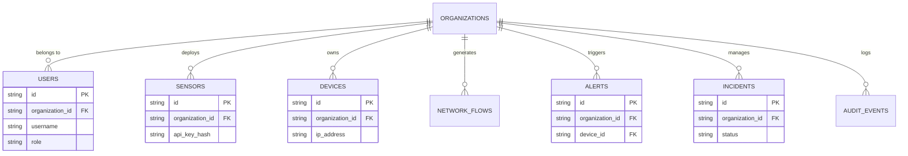

# Multi-Tenant Security & Data Isolation Architecture

This document describes the multi-tenant data partitioning, isolation guarantees, and Insecure Direct Object Reference (IDOR) prevention implemented in Pahredaar-IoT.

---

## 1. Multi-Tenant Tenancy Model

Pahredaar-IoT implements **Logical Database Isolation with Row-Level Scoping** using a tenant identifier (`organization_id`):
- Every tenant represents an independent corporate entity or operational domain (`Organization`).
- All critical business entities—including `devices`, `network_flows`, `alerts`, `incidents`, `sensors`, `audit_events`, and `risk_history`—contain a mandatory foreign key or column `organization_id`.
- The caller's `organization_id` is derived strictly from verified credentials (JWT token claim `org_id` or authenticated Sensor identity `sensor.organization_id`).



---

## 2. Insecure Direct Object Reference (IDOR) Prevention

Client-supplied primary keys (such as `device_id`, `incident_id`, or `alert_id`) are never resolved globally. Every database query enforces compound constraints pairing the object identifier with the caller's verified `organization_id`:

```python
# IDOR-Safe Query Pattern in incident_repo.py
async def get_incident_by_id(
    session: AsyncSession,
    incident_id: str,
    organization_id: str
) -> Optional[Incident]:
    stmt = (
        select(Incident)
        .where(
            Incident.id == incident_id,
            Incident.organization_id == organization_id  # Hard tenant boundary
        )
    )
    res = await session.execute(stmt)
    return res.scalars().first()
```

If User A in Organization 1 attempts to acknowledge or resolve an incident belonging to Organization 2 by guessing or brute-forcing its UUID:
1. The repository query returns `None` (0 rows matched).
2. The endpoint returns `404 Not Found` (or `403 Forbidden`).
3. An audit log event records an unauthorized cross-tenant access attempt.

---

## 3. Real-Time WebSocket Channel Partitioning

WebSocket alert broadcasts are partitioned per tenant organization:
```python
class ConnectionManager:
    def __init__(self):
        # organization_id -> set of active WebSockets
        self.active_connections: Dict[str, Set[WebSocket]] = {}

    async def broadcast_alert(self, alert_data: dict, organization_id: str = "default-org"):
        conns = list(self.active_connections.get(organization_id, set()))
        for conn in conns:
            await conn.send_json(alert_data)
```

Clients connected with a JWT for `org_A` will never receive alert broadcasts, device updates, or incident events generated by `org_B`.

---

## 4. Multi-Tenant Verification & Automated Testing

The multi-tenancy implementation is verified in `tests/security/test_multi_tenancy.py`:
- `test_cross_tenant_isolation_alerts`: Ingests flows for Org A and Org B; verifies queries scoped to Org A return only Org A alerts, and Org B queries return only Org B alerts.
- `test_cross_tenant_idor_incident_resolution`: User from Org A attempts to resolve an incident belonging to Org B; verifies server rejects with `404` and preserves incident state.
