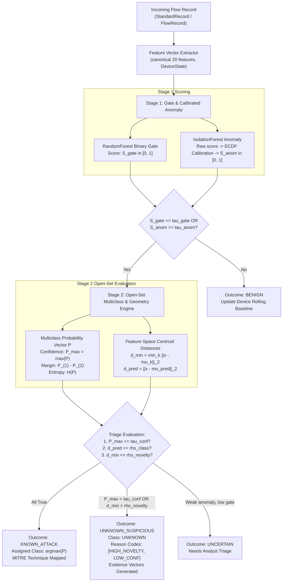

# Pahredaar-IoT — Open-Set Recognition & Unknown Attack Detection Design
**Document Version:** 1.0 (Phase 3 Specification)  
**Status:** Approved Design Document  
**Authors:** Senior Machine Learning Engineer & Principal Cybersecurity Architect  

---

## 1. Problem Formulation: The Closed-Set Trap in Network Security

Traditional supervised intrusion detection models assume the **closed-world assumption**: all traffic observed at inference time belongs to one of the $K$ classes seen during training ($\mathcal{Y}_{train} = \{c_1, c_2, \dots, c_K\}$).

In real IoT deployments, this assumption is fatally flawed:
1. **Adversarial Novelty:** Attackers engineer novel protocols, evasion encodings, and unseen exploit chains.
2. **Forced Misclassification:** A standard Softmax or RandomForest classifier outputs probabilities that sum to 1 ($\sum_{k=1}^K P(y=k \mid \mathbf{x}) = 1$). When presented with a zero-day worm or novel protocol abuse, the model is mathematically forced to assign 100% of its probability mass across the $K$ known training labels.
3. **Catastrophic Blind Spots:** Treating all outliers as an undifferentiated "Other" class in training does not solve the problem because training cannot sample the infinite space of future attacks.

---

## 2. Formal Open-Set Detection Definition

Let $\mathcal{X} \subset \mathbb{R}^D$ be the canonical feature space ($D=20$).  
Let $\mathcal{Y}_{known} = \{\text{BENIGN}, \text{PORT\_SCAN}, \text{DDOS}, \text{BRUTE\_FORCE}, \text{MIRAI\_BEACON}\}$.  
Let $\mathcal{U}$ represent the open space of all unobserved, zero-day, or novel attack distributions.

The open-set recognition system maps an incoming feature vector $\mathbf{x} \in \mathcal{X}$ into one of **four distinct operational outcomes**:

$$\mathcal{D}(\mathbf{x}) \in \{\text{BENIGN}, \text{KNOWN\_ATTACK}, \text{UNKNOWN\_SUSPICIOUS}, \text{UNCERTAIN}\}$$

### Decision Criteria:

1. **`BENIGN` (Known Benign):**
   - The flow exhibits statistical properties consistent with established device baselines and the training benign distribution.
   - Binary Gate score $S_{gate}(\mathbf{x}) < \tau_{gate}$ AND Calibrated Anomaly Score $S_{anom}(\mathbf{x}) < \tau_{anom\_low}$.

2. **`KNOWN_ATTACK` (Recognized Known Attack):**
   - The flow is flagged as anomalous or malicious by Stage 1 ($S_{gate} \ge \tau_{gate}$ or $S_{anom} \ge \tau_{anom\_high}$).
   - The multiclass classifier expresses high confidence: $\max_k P(y=k \mid \mathbf{x}) \ge \tau_{conf}$.
   - The sample resides within the bounded neighborhood of the predicted class centroid in feature space: $\text{dist}(\mathbf{x}, \mathbf{\mu}_{\hat{y}}) \le \rho_{\hat{y}}$.

3. **`UNKNOWN_SUSPICIOUS` (Zero-Day / Novel Suspicious Attack):**
   - The flow is flagged as non-benign by Stage 1 ($S_{gate} \ge \tau_{gate}$ or $S_{anom} \ge \tau_{anom\_high}$).
   - **BUT** fails known-class assignment due to any of the following statistical conditions:
     - **High Classifier Uncertainty:** $\max_k P(y=k \mid \mathbf{x}) < \tau_{conf}$ (model cannot confidently classify the attack).
     - **High Softmax Entropy:** $H(\mathbf{P}) = -\sum_k P_k \log P_k > \tau_{entropy}$.
     - **Feature-Space Out-of-Distribution (OOD):** Distance to all known class centroids exceeds the novelty boundary: $\min_k \text{dist}(\mathbf{x}, \mathbf{\mu}_k) > \rho_{novelty}$.
     - **Severe Behavioral Anomaly:** Unsupervised anomaly score exceeds extreme threshold ($S_{anom} \ge \tau_{extreme}$).

4. **`UNCERTAIN` (Borderline / Ambiguous):**
   - Anomaly score is elevated near boundary ($\tau_{anom\_low} \le S_{anom} < \tau_{anom\_high}$), but gate score is below threshold and feature distance is indeterminate. Requires analyst investigation without triggering a high-priority incident.

---

## 3. Mathematical Architecture & Decision Pipeline

---

## 4. Algorithms Selected for Open-Set Triage

### 4.1 Empirical CDF Anomaly Calibration
Raw Isolation Forest scores $s_{raw}(\mathbf{x}) = -\text{score\_samples}(\mathbf{x})$ are unbounded and vary across training sets.  
We calibrate raw scores using the Empirical Cumulative Distribution Function ($\text{ECDF}$) fit strictly on the validation benign partition:

$$\text{ECDF}(s) = \frac{1}{N_{val\_benign}} \sum_{i=1}^{N_{val\_benign}} \mathbb{I}(s_i \le s)$$

The calibrated anomaly score $S_{anom}(\mathbf{x}) \in [0, 1]$ represents the exact percentile of anomalousness relative to normal traffic.

### 4.2 Centroid-Based Feature Space Distance
For each known class $k \in \mathcal{Y}_{known}$, we compute the standardized centroid in the scaled feature space:

$$\mathbf{\mu}_k = \frac{1}{N_k} \sum_{i=1}^{N_k} \mathbf{x}_i^{(k)}$$

The novelty score $\mathcal{N}(\mathbf{x})$ is defined as the normalized Euclidean distance to the nearest known class centroid:

$$\mathcal{N}(\mathbf{x}) = \min_{k \in \mathcal{Y}_{known}} \|\mathbf{x} - \mathbf{\mu}_k\|_2$$

The radius $\rho_k$ is calibrated as the 95th percentile distance of training samples belonging to class $k$. If a sample falls outside $\rho_k$, it is rejected as out-of-distribution.

### 4.3 Multiclass Confidence & Margin Rejection
- **Maximum Softmax Probability (MSP):** $P_{max} = \max_k P(y=k \mid \mathbf{x})$.
- **Confidence Margin:** $\Delta_P = P_{(1)} - P_{(2)}$ (difference between the highest and second-highest probabilities).
- When $\Delta_P < 0.20$ or $P_{max} < 0.65$, the classifier is uncertain and rejects the known label.

---

## 5. Leakage-Safe Held-Out Evaluation Protocol

To empirically evaluate Phase 3 without data leakage:
1. **Known Classes ($\mathcal{Y}_{train}$):** `BENIGN`, `PORT_SCAN`, `DDOS`.
2. **Held-Out Unknown Class ($\mathcal{Y}_{unknown}$):** `BRUTE_FORCE` and `MIRAI_BEACON` are **completely removed** from training and validation threshold calibration.
3. **Threshold Calibration:** Operating thresholds ($\tau_{gate}, \tau_{anom}, \tau_{conf}, \rho_{novelty}$) are determined strictly on the validation partition containing only $\mathcal{Y}_{train}$.
4. **Final Test Evaluation:** Scored on the held-out test partition containing both known attacks and the held-out unknown attack family.
5. **Success Metrics:**
   - **Unknown Attack Detection Rate (UDR / Recall):** Proportion of true unknown attacks correctly flagged as `UNKNOWN_SUSPICIOUS`.
   - **False Unknown Rate on Benign (FUR):** Proportion of benign traffic incorrectly flagged as unknown.
   - **False Rejection Rate on Known (FRR):** Proportion of known attacks incorrectly rejected as unknown.
   - **Open-Set Classification Rate (OSCR):** Trade-off curve between correct known classification and unknown rejection.
