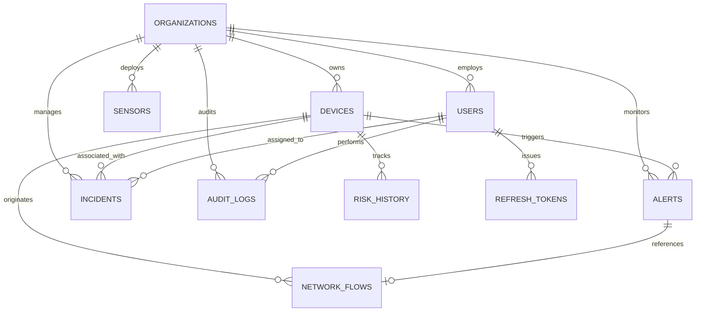

# Phase 6 Architecture & Migration Audit

**Project:** Pahredaar-IoT Enterprise Intrusion Detection Platform  
**Target Milestone:** Phase 6 — Enterprise Backend, PostgreSQL Migration, JWT Authentication, RBAC & Multi-Tenant Security  
**Repository Baseline Commit:** `a82307a`  
**Test Baseline:** 94 / 94 passed (100%)  
**Audit Date:** 2026-11-13  

---

## 1. Executive Summary

Pahredaar-IoT has evolved through Phases 1–5 from a single-node prototype into an advanced multi-modal hybrid AI intrusion detection system featuring:
- High-fidelity packet/flow normalization (IoT-23, CICIoT2023, TON_IoT).
- 4-way Open-Set unknown attack triage (AUROC up to 0.9999).
- Exact TreeSHAP local explanations and Causal LSTM temporal sequence modeling.
- Communication graph topology tracking and non-dilutive hierarchical risk scoring ($\rho = 0.8245$).
- Ingestion rate limiting, alert storm deduplication, and MTTA/MTTR incident tracking.

However, the current storage and access control architecture exhibits critical enterprise limitations:
1. **Single-Tenant SQLite Concurrency:** All flows, alerts, devices, and incidents are stored in a single SQLite database (`iot_ids.db`). While guarded with mutex locks and a deterministic `db_session()` context manager, SQLite locks the entire database on writes, capping single-threaded write throughput to ~100 flows/sec.
2. **Lack of Tenant Scoping:** Data belongs to a single flat namespace. If deployed across multiple clients, smart facilities, or enterprise branches, Organization A would see Organization B's devices, alerts, and incidents.
3. **Static Sensor Authentication:** Authentication is limited to a single shared static `API_KEY` string compared via constant-time equality. There is no sensor identity tracking, no key lifecycle (rotation, revocation, scoping), and no per-sensor audit trail.
4. **No User Authentication & Authorization:** REST and WebSocket endpoints are open to all network callers with zero identity verification, no RBAC, and no session management.
5. **No Migration Tooling:** Schema modifications were managed via procedural `ALTER TABLE` statements inside `init_db()`. Enterprise deployments require declarative Alembic migrations.

---

## 2. Inventory of Current Persistent Endpoints & Queries

### 2.1 SQLite Schema & Access Patterns (`backend/app/storage.py`)

| Table | Primary Access Patterns | Current SQLite Query Style | Volume Characteristics |
|---|---|---|---|
| `flows` | Append-only flow logs with ML gate scores. | `INSERT INTO flows ...` | High frequency (100–1,000s/sec in batches) |
| `alerts` | Anomaly / attack events with SHAP and risk breakdown JSON. | `INSERT INTO alerts ...`<br>`SELECT * FROM alerts ORDER BY id DESC LIMIT ?` | Medium frequency (alerts on flagged flows) |
| `devices` | Device state, risk score, temporal/graph risk, counters. | Upsert pattern (`SELECT WHERE device_id=?` then `UPDATE` or `INSERT`). | Low frequency (1 row per unique IoT device) |
| `incidents` | Correlated security incidents with status lifecycle. | `SELECT ... WHERE device_id=? AND status IN ('OPEN', 'ACKNOWLEDGED')`<br>`UPDATE incidents ...`<br>`INSERT INTO incidents ...` | Low frequency, state-machine transitions |

### 2.2 API Endpoints & Current Access Control (`backend/app/main.py`)

| Endpoint | Method | Current Auth | Target Auth (Phase 6) | Tenant Scoping |
|---|---|---|---|---|
| `/api/health` | GET | None (Public) | None (Public) | Global / System Health |
| `/api/ingest` | POST | Optional `API_KEY` (`verify_sensor_auth`) | Sensor API Key (Cryptographic hash) or Bearer Token | Scoped to Sensor's `organization_id` |
| `/api/ingest/batch` | POST | Optional `API_KEY` | Sensor API Key (Cryptographic hash) or Bearer Token | Scoped to Sensor's `organization_id` |
| `/api/alerts` | GET | None | JWT (Viewer, Analyst, Admin) | Scoped to User's `organization_id` |
| `/api/devices` | GET | None | JWT (Viewer, Analyst, Admin) | Scoped to User's `organization_id` |
| `/api/stats` | GET | None | JWT (Viewer, Analyst, Admin) | Scoped to User's `organization_id` |
| `/api/incidents` | GET | None | JWT (Viewer, Analyst, Admin) | Scoped to User's `organization_id` |
| `/api/incidents/{id}/ack` | POST | None | JWT (Analyst, Admin) | Must belong to User's `organization_id` |
| `/api/incidents/{id}/res` | POST | None | JWT (Analyst, Admin) | Must belong to User's `organization_id` |
| `/api/incidents/metrics` | GET | None | JWT (Viewer, Analyst, Admin) | Scoped to User's `organization_id` |
| `/ws/alerts` | WS | None (Broadcasts to all) | JWT Token / Ticket in query parameter | Subscribed exclusively to User's `organization_id` |

---

## 3. Normalized Enterprise Database Architecture

Phase 6 introduces a normalized, multi-tenant relational schema supported on both **PostgreSQL (with optional TimescaleDB)** and **SQLite (for local development/testing)** via SQLAlchemy 2.x ORM with `AsyncSession`.



### 3.1 Normalized Schema Definitions
1. **`organizations`**: Master tenant entity. Every resource in the system carries an indexed `organization_id` foreign key.
2. **`users`**: System operators with Argon2id password hashing, email validation, and role assignment (`admin`, `analyst`, `viewer`).
3. **`refresh_tokens`**: Secure token persistence with cryptographic hash storage, expiration, family-based rotation, and instant revocation upon reuse detection.
4. **`sensors`**: Registered network capture probes (Zeek bridge, packet taps). Stores SHA-256 API key hashes (`api_key_hash`), rate limit profiles, and heartbeats.
5. **`devices`**: Discovered IoT network nodes with MAC/IP, device type, risk tier, and continuous temporal/graph threat state.
6. **`network_flows`**: Captured bidirectional flow records, extracted features (JSONB/JSON), gate scores, and flag decisions.
7. **`alerts`**: High-priority threat alerts including TreeSHAP explanations, novelty scores, and risk decompositions.
8. **`incidents`**: Correlated security incidents with lifecycle transitions (`OPEN` $\to$ `ACKNOWLEDGED` $\to$ `RESOLVED`), MTTA/MTTR timestamps, and resolution notes.
9. **`risk_history`**: Time-series log of composite device risk and event threats over time.
10. **`audit_events`**: Immutable append-only audit trail capturing security-sensitive actions (logins, key rotations, incident state transitions).
11. **`model_metadata`**: Version tracking, artifact SHA-256 checksums, and deployment timestamps.

---

## 4. Multi-Tenant Isolation Strategy

Tenant isolation is enforced strictly at the database query and service layer, preventing cross-tenant leakage:
1. **Implicit Tenant Resolution:** The client never specifies `organization_id` in request payloads. The active tenant is extracted exclusively from the authenticated JWT token claims or sensor API key.
2. **Query Scoping Enforcement:** All database repositories append `.where(Model.organization_id == active_org_id)`.
3. **Object-Level Authorization:** Accessing an incident by ID (`/api/incidents/{incident_id}`) verifies both the incident ID and the organization ID. Requests for incidents outside the active tenant return HTTP 404 (preventing ID enumeration).
4. **WebSocket Channel Partitioning:** The WebSocket `ConnectionManager` maintains per-organization client pools:
   ```python
   self.org_connections[org_id].append(websocket)
   ```
   Alert broadcasts are directed strictly to the matching organization pool.

---

## 5. Security & Authentication Design

### 5.1 Password Hashing: Argon2id
Argon2id (via `argon2-cffi`) provides state-of-the-art resistance against GPU/ASIC cracking, memory-hard attacks, and side-channel timing attacks.

### 5.2 JWT Lifecycle
- **Access Tokens:** Signed with HMAC-SHA256 (`HS256`), 15-minute expiration, containing `sub` (user_id), `org_id`, `role`, and `type="access"`.
- **Refresh Tokens:** High-entropy cryptographically random strings (64 bytes hex), stored as SHA-256 hashes in the database with 7-day expiration.
- **Rotation & Reuse Detection:** Each refresh request invalidates the used refresh token and issues a new pair. If an already-used refresh token is presented (indicating token theft), the entire token family is revoked immediately, logging a critical audit event.

### 5.3 Sensor Key Management
- Sensors are provisioned via administrative API (`POST /api/sensors`).
- A high-entropy key (`pahredaar_sk_<random32>`) is generated and shown to the administrator **only once**.
- The database stores only the `api_key_hash = sha256(raw_key)`.
- Sensors authenticate using `X-Sensor-Key: <raw_key>` or `Authorization: Bearer <raw_key>`.

---

## 6. Migration Strategy: Zero Downtime & Backward Compatibility

To preserve the 94 passing regression tests while upgrading to SQLAlchemy 2.x and PostgreSQL:
1. **Dual Driver Architecture:**
   - Development & Pytest: `sqlite+aiosqlite:///...` (with synchronous fallback in `storage.py`).
   - Production: `postgresql+asyncpg://...`.
2. **Backward-Compatible Database Layer:**
   - Existing functions in `backend/app/storage.py` are preserved and wired to the default organization (`default-org-id`) when called without an organization context.
   - New async repository interfaces (`backend/app/database/repositories/`) handle async, multi-tenant SQLAlchemy operations.
3. **Data Migration Utility:**
   - `backend/scripts/migrate_sqlite_to_postgres.py` performs safe, chunked transfer of legacy flows, alerts, devices, and incidents from SQLite into PostgreSQL under an automatically initialized default organization.
   - Includes `--dry-run`, checksum verification, and foreign-key integrity validation.

---

## 7. Audit Sign-Off

- [x] All 94 regression tests verified passing on baseline commit `a82307a`.
- [x] Python 3.14 environment compatibility verified for `SQLAlchemy 2.0.52`, `asyncpg 0.31.0`, `aiosqlite 0.22.1`, `alembic 1.20.1`, `argon2-cffi 25.1.0`, `PyJWT 2.15.1`.
- [x] Architecture design completed. Proceeding to Subphase 6A (Database Architecture & Models).
