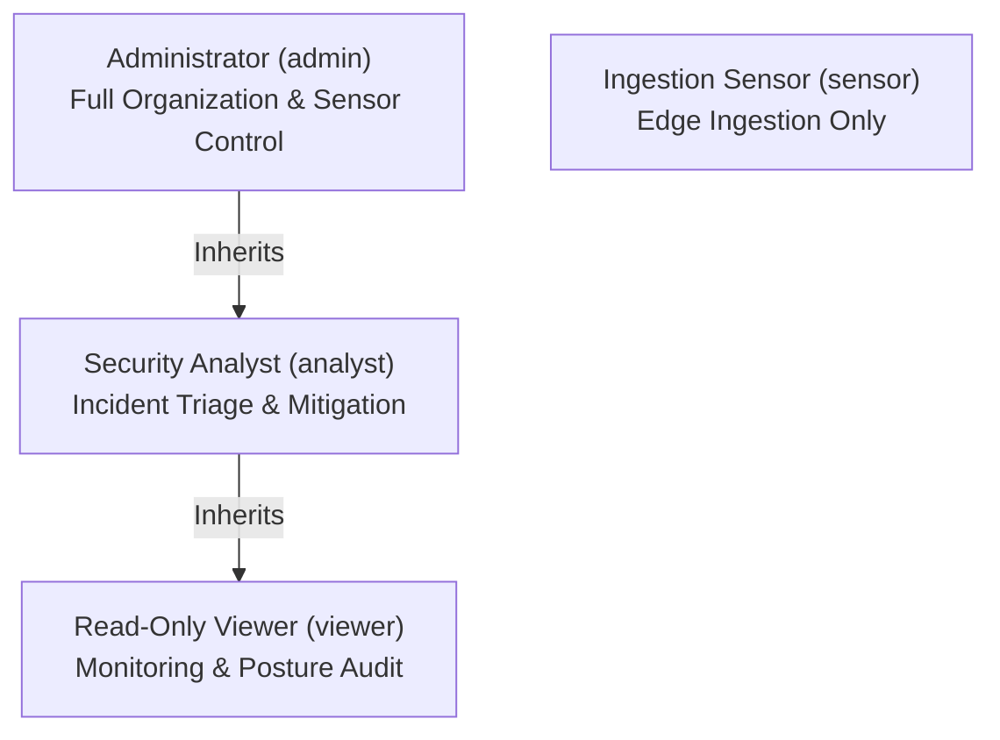

# Role-Based Access Control (RBAC) Specification

This document details the Role-Based Access Control (RBAC) architecture, permissions matrix, and enforcement mechanisms in Pahredaar-IoT.

---

## 1. Roles & Hierarchy

Pahredaar-IoT defines 4 discrete enterprise roles with least-privilege scoping:



### Role Definitions

1. **Administrator (`admin`)**:
   - Manages tenant organization configuration, users, and credentials.
   - Authorizes and provisions edge sensors, rotates API keys, and deactivates compromised collectors.
   - Has full authority to acknowledge and resolve incidents, adjust detection thresholds, and access immutable audit logs.

2. **Security Analyst (`analyst`)**:
   - Triages real-time alerts, monitors device posture and MITRE ATT&CK mappings.
   - Inspects TreeSHAP explainability feature attributions and anomaly geometries.
   - Acknowledges (`ACK`) and resolves (`RESOLVED`) security incidents.
   - Cannot manage users, organization settings, or rotate sensor API keys.

3. **Read-Only Viewer (`viewer`)**:
   - Accesses dashboard summaries, live alerts, device risk cards, and compliance reports.
   - Cannot mutate incident lifecycles, register devices, or reconfigure sensors.

4. **Edge Sensor (`sensor`)**:
   - Non-human service identity utilized by Zeek monitors, Snort daemons, and edge telemetry agents.
   - Exclusively authorized to ingest flow records (`POST /api/ingest`).
   - Strictly forbidden from reading alerts, incidents, user lists, or audit logs.

---

## 2. Granular Permissions Matrix

| Permission | Description | Admin | Analyst | Viewer | Sensor |
| :--- | :--- | :---: | :---: | :---: | :---: |
| `traffic:ingest` | Stream network flows to AI detection engine |  |  |  |  |
| `alerts:read` | Read live alerts and risk metrics |  |  |  |  |
| `devices:read` | View device inventory and risk posture |  |  |  |  |
| `devices:write` | Register or update device metadata |  |  |  |  |
| `incidents:read` | Read incident timelines and MTTA/MTTR metrics |  |  |  |  |
| `incidents:write` | Acknowledge or resolve security incidents |  |  |  |  |
| `sensors:manage` | Provision, rotate, or deactivate edge sensors |  |  |  |  |
| `users:manage` | Manage tenant user accounts and RBAC assignments |  |  |  |  |
| `audit:read` | View immutable security compliance audit logs |  |  |  |  |

---

## 3. Server-Side Enforcement Architecture

All RBAC permissions are enforced server-side using FastAPI dependency injection (`Depends(require_roles(...))` and `Depends(require_permissions(...))`). Client-side checks are strictly cosmetic.

```python
# Enforcement Example: Incident Resolution
@app.post("/api/incidents/{incident_id}/resolve")
async def resolve_incident_endpoint(
    incident_id: str,
    req: IncidentResolveRequest,
    current_user: User = Depends(require_roles([Role.ADMIN, Role.ANALYST])),
    db: AsyncSession = Depends(get_db)
):
    ...
```

- If an unauthenticated request attempts access, the framework returns `401 Unauthorized`.
- If an authenticated caller lacks the required role or permission, the framework returns `403 Forbidden` (`{"detail": "Forbidden: Requires one of [admin, analyst] roles"}`).
