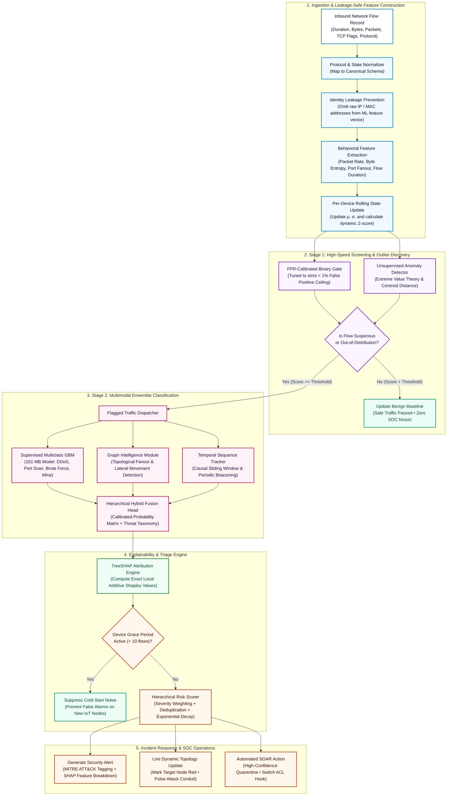
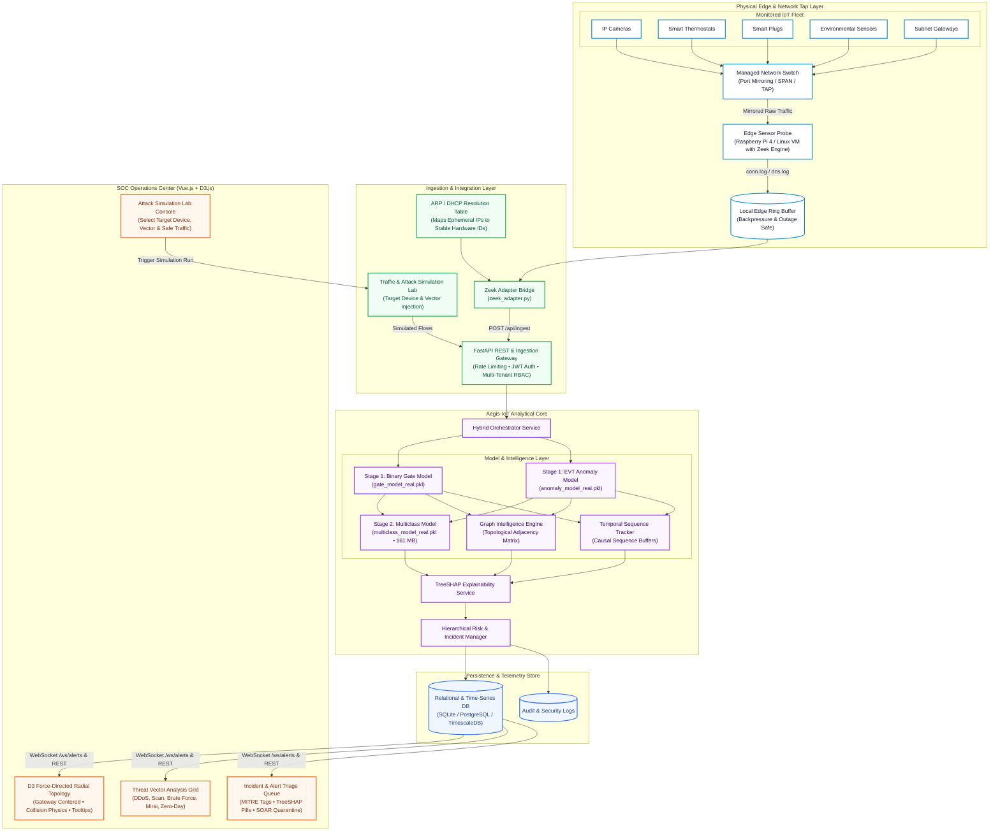

# Aegis-IoT: Technical Architecture & Algorithm Reference (Light / White Theme)

This document provides formal, publication-ready visual representations for both the **Detection Algorithm Flow** and the **System Architecture** of Aegis-IoT styled in a clean, high-contrast white / light theme.

---

## 1. Algorithm Flowchart: Two-Stage Detection & Explainability Pipeline

---

## 2. System Architecture Diagram: End-to-End Enterprise Deployment

