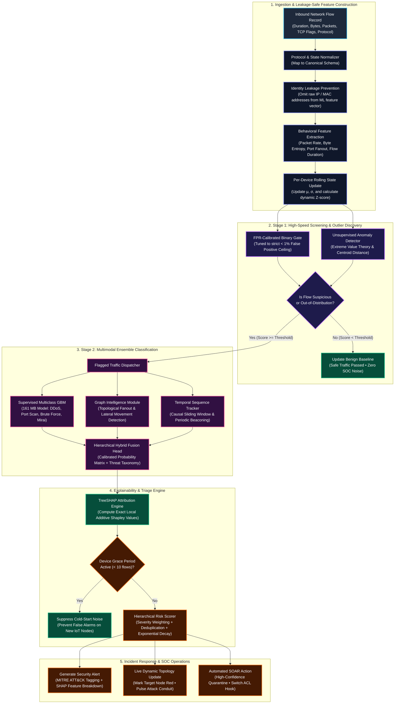
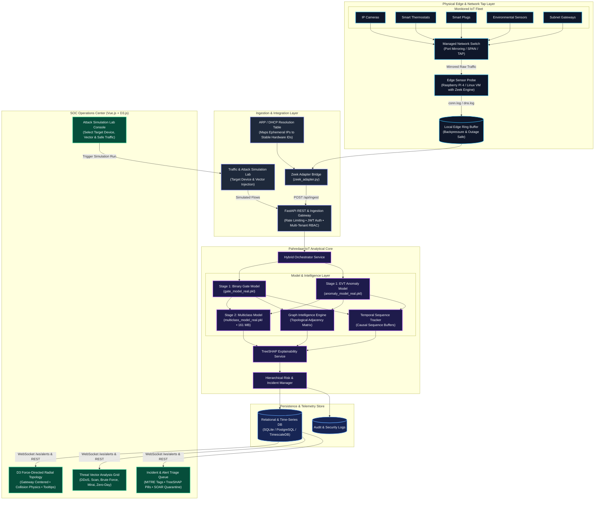

# Pahredaar-IoT: Technical Architecture & Algorithm Reference

This document provides formal visual representations for both the **Detection Algorithm Flow** and the **System Architecture** of Pahredaar-IoT.

---

## 1. Algorithm Flowchart: Two-Stage Detection & Explainability Pipeline

This diagram explains the mathematical and algorithmic progression of every network flow through the system: from raw packet ingestion and leakage-safe feature construction, through the two-stage detection funnel (with Extreme Value Theory for zero-day discovery), to TreeSHAP attribution and hierarchical alert triage.

### Key Algorithmic Steps:
1. **Zero-Identity Leakage Extraction**: Network flows pass through a filter that strips raw IP and MAC identities. Only statistical rates, entropy, port fanouts, and rolling deviations enter the models.
2. **Two-Stage Funnel**: 
   - **Stage 1 (Binary Gate + EVT)** processes 100% of network traffic at high speed. It enforces an operational False Positive Rate ceiling of $<1\%$ while Extreme Value Theory (EVT) detects novel out-of-distribution behaviors (zero-days).
   - **Stage 2 (Heavy Ensemble)** only fires on flagged traffic ($\approx 5-10\%$ of total flows). It combines multiclass supervised predictions with graph topological lateral-movement tracking and temporal sequence analysis.
3. **Local Explainability (TreeSHAP)**: Every generated alert includes exact Shapley attributions, highlighting the exact feature spikes that caused the alert.
4. **Hierarchical Risk & Triage**: Alerts are filtered by a new-device grace period, deduplicated across time windows, and decayed exponentially to eliminate alert fatigue.

---

## 2. System Architecture Diagram: End-to-End Enterprise Deployment

This diagram shows how the system deploys across physical network hardware, the ingestion pipeline, the analytical engine, and the frontend SOC operations console.

### Architectural Highlights:
1. **Edge Tap Non-Invasiveness**: Passive monitoring via SPAN/TAP mirror ports ensures zero latency impact on IoT devices.
2. **Resilience & Local Buffering**: Edge sensor probes buffer packets locally to handle network disconnects or collector maintenance without flow loss.
3. **Decoupled Ingestion**: The REST ingestion contract accepts standard `FlowRecord` JSON from both live physical Zeek probes and the interactive Simulation Lab.
4. **Multi-Tenant Security**: Full JWT authentication, role-based access control (RBAC), and strict organization isolation at the database and WebSocket layers.
5. **Real-Time Interactive SOC Interface**: D3.js force-directed topology visualizer with real-time WebSocket feeds and automated SOAR response hooks.
